# Secure the Grid: WRITEUP

Track: UTC Secure the Grid. Each answer is labeled by step and Part. The run record for every cloud run is at the end.

# Step 1: Catch the Eavesdropper (BB84)

## Step 1, Part 1: BB84 and Eavesdropper Detection

The team built a BB84 simulation to show how two people can create a shared secret key and check whether someone may have intercepted the qubits. Alice generates random bits and randomly chooses a basis for each one. She encodes each bit as a qubit and sends it to Bob. Bob independently chooses a random basis to measure each qubit. Afterward, Alice and Bob compare their basis choices over a public channel and keep only the bits where they used the same basis. These remaining bits are called the sifted key.

The team tested an intercept-and-resend eavesdropper. Eve measures each qubit in a randomly chosen basis, then prepares a new qubit based on her result and sends it to Bob. If Eve chooses the wrong basis, her measurement can change the state. Alice and Bob estimate the quantum bit error rate (QBER) by comparing their sifted bits.

## Step 1, Part 2: Results

With no eavesdropper, the local simulator produced a QBER of 0.0. With Eve intercepting and resending the qubits, the QBER was 0.243, or about 24%. This is close to the expected error rate of about 25% for this attack: Eve chooses the wrong basis about half the time, and those wrong-basis measurements cause errors in about half of the affected sifted bits. The exact result can vary between runs because the bits, bases, and measurements are random.

The team also tested a batched circuit with 16 qubits and 200 shots. The local simulator gave a QBER of 0.0. The IonQ simulator run gave a QBER of 0.001. Its job ID was `ionq:ionq:sim:simulator-b095-qjob-6af88876c8f5265fb3f1bd01`.

The team then ran the batched circuit on the IonQ Forte 1 quantum processor through Open Quantum, using 200 shots. The hardware QBER was 0.004, or about 0.4%. Its job ID was `openquantum:ionq:qpu:forte-1-b095-qjob-6af88c54c8f5265fb3f1bdde`. This hardware run did not include Eve; the Eve result came from the local simulator.

## Step 1, Part 3: What the Result Shows

The comparison shows how an intercept-and-resend attack can raise the error rate in the sifted key. A higher QBER can warn Alice and Bob that the communication may have been disturbed. It does not identify who caused the errors: noise, transmission problems, or device errors could also raise QBER. A QBER of 0.0 in one run does not prove that nobody intercepted the qubits.

For this demonstration, a QBER around 10% or higher would be a useful warning threshold. It is well above the 0.4% hardware baseline from this run and below the roughly 25% expected from the simulated intercept-and-resend attack. This is only an illustrative threshold for these tests, not a setting for a real QKD system. The threshold for a deployed system would need to account for its measured noise, sample size, and security requirements.

The team also tested a spy who only intercepts some of the qubits (the sweep cell in the notebook). The expected error rate is about one quarter of the fraction Eve intercepts. If Eve intercepts only 2% of the qubits, the expected QBER is about 0.5%, which is close to the 0.4% the hardware showed with no spy at all. So a careful spy who only listens to a few qubits could hide inside normal noise.

Real QKD systems handle this by assuming every error was caused by a spy. They fix the errors with error correction and then use privacy amplification, which shrinks the key until the spy knows almost nothing about what is left. The more errors there are, the more the key shrinks. Above about 11% QBER, BB84 cannot produce a secure key at all and the key is thrown away (Shor and Preskill, 2000).

## Step 1, Part 4: Limits and Use in the Grid

This is a small demonstration of BB84, not a complete key distribution system. In a real deployment, Alice and Bob would need to authenticate their public discussion, compare a sample of the sifted key, and discard the tested bits. They would also need error correction and privacy amplification before using the remaining bits as a key.

BB84 can help protect a key exchange on a suitable quantum link, but it does not encrypt grid traffic by itself or secure every substation and control center. The resulting key would still need to be used by ordinary encryption equipment. These tests do not demonstrate a deployed fiber link or prove that QKD is the most cost-effective choice for a utility. A smaller or resource-limited grid would need to compare QKD’s cost and operating requirements with post-quantum cryptography.

Real QKD systems have been attacked through their hardware and not through the math. In 2010, researchers showed that the detectors in two commercial QKD systems could be controlled with bright light, which let an attacker learn the key without causing errors (Lydersen et al., 2010).

The NSA does not recommend QKD for national security systems. It says QKD does not authenticate who sent the key, needs special equipment, often needs trusted relays, is hard to validate, and raises the risk of denial of service. The UK NCSC says QKD does not provide authentication, will not support it for government or military use, and recommends post-quantum cryptography as the main fix.

Sources:

- P. Shor and J. Preskill, "Simple Proof of Security of the BB84 Quantum Key Distribution Protocol," 2000. https://arxiv.org/abs/quant-ph/0003004
- L. Lydersen et al., "Hacking commercial quantum cryptography systems by tailored bright illumination," 2010. https://arxiv.org/abs/1008.4593
- NSA, "Quantum Key Distribution (QKD) and Quantum Cryptography (QC)." https://www.nsa.gov/Cybersecurity/Quantum-Key-Distribution-QKD-and-Quantum-Cryptography-QC/
- UK NCSC, "Quantum networking technologies." https://www.ncsc.gov.uk/paper/quantum-networking-technologies

## Step 1, Results Table

| Run | Device | Job ID | Shots | Status | Result |
|---|---|---|---|---|---|
| No eavesdropper | Aer local simulator | none (local run) | 200 qubits, 1 shot each | Completed | QBER 0.0 |
| With eavesdropper | Aer local simulator | none (local run) | 200 qubits, 1 shot each | Completed | QBER 0.243 |
| Batched, 16 rounds | Aer local simulator | none (local run) | 200 | Completed | QBER 0.0 |
| Batched, 16 rounds | IonQ simulator | ionq:ionq:sim:simulator-b095-qjob-6af88876c8f5265fb3f1bd01 | 200 | Completed | QBER 0.001 |
| Batched, 16 rounds | IonQ Forte 1 QPU (Open Quantum) | openquantum:ionq:qpu:forte-1-b095-qjob-6af88c54c8f5265fb3f1bdde | 200 | Completed | QBER 0.004 |

**Note** The local simulator has no noise, so it shows 0.0 with no eavesdropper. The IonQ simulator and the real IonQ Forte machine both stayed under 0.5%. With the eavesdropper the error rate jumped to about 24%, which is far above anything the noise caused.

## Step 1, Stretch: Backends and Quantum Random Bits

**Backends compared.** The same BB84 circuit with no eavesdropper was run on three qBraid backends (`3f_attacks_on_hardware.ipynb`). The QIR simulator gave a QBER of 0.000, IonQ's simulator with its noise model gave 0.000, and Quantinuum's H2 emulator gave 0.001. IonQ Forte 1, run in Part 2, gave 0.004.

The results differ because each backend models a different noise source:
- The QIR simulator models no noise at all.
- IonQ's noise model puts most of its error on two-qubit gates. A BB84 round with no eavesdropper uses only X and H gates, so there is almost nothing for that noise to act on.
- The H2 emulator also models readout error, which flips a measured bit whatever the gates were.
- The real Forte run includes every error source at once.

With the eavesdropper added, both noisy backends showed the expected jump: 0.242 on IonQ and 0.259 on H2. The CNOT used to model Eve's copy finally gave IonQ's two-qubit noise something to act on.

For the alarm threshold, the lesson is that the baseline must be measured on the actual link. A threshold tuned on a noise-free simulator would be too strict for real fiber. One tuned on a noisy backend would be too loose for a quiet link.

**Quantum random bits.** Alice's bits, Alice's bases and Bob's bases were also taken from a quantum random number generator: 12 qubits, each put in superposition with H and measured, over 3 shots, which gives 36 bits. BB84's security assumes Eve cannot predict the bases. A software random generator is a formula: anyone who learns its seed can reproduce every basis choice and measure each photon in the right basis, causing no errors at all. Measuring a qubit in superposition has no seed to steal. One caveat: on a simulator, the "quantum" bits are produced by the simulator's own pseudorandom generator. Only a real QPU or a hardware QRNG gives randomness that comes from physics.

# Step 2: Size Up the Threat

## Step 2, Part 1: Shor Demo (Factor 15)

The team ran Shor's period-finding circuit for N = 15 with base 7. The most useful measured phase was 3/4, giving a period of 4. Using that period, gcd(7² − 1, 15) and gcd(7² + 1, 15) recovered the factors 3 and 5 respectively. Working through the steps showed that the quantum computer's only job is finding the period; the rest is ordinary arithmetic. Since RSA's security depends on factoring being hard, and a variant of Shor's algorithm solves the discrete logarithm problem behind elliptic-curve cryptography, this is the threat to most of the public-key encryption a utility uses today.

## Step 2, Part 2: How Far Is Real Hardware?

The largest machine available through qBraid has 107 qubits, Rigetti Cepheus-1-108Q. For comparison, our factor-15 demo used 8 counting qubits and 4 work qubits for a total of 12. According to Google Quantum AI researcher Gidney (2025), breaking RSA-2048 would take approximately 1,400 error-corrected (logical) qubits, built from just under one million noisy physical qubits, running for under a week. Given Rigetti's max of 107 qubits, the problem would require roughly 9,000 times more physical qubits than currently available, about four orders of magnitude.

In 2019, Gidney and Ekerå estimated 20 million physical qubits for the same task; the 20-fold drop in six years indicates that the gap, while real, is shrinking quickly.

However, qubit count alone understates the gap present. The one million figure already includes the cost of error correction, roughly 700 physical qubits per logical qubit, but it assumes every gate across the entire machine has an error rate of 0.1% or better. Today's devices approach that rate only on small chips, not at the scale of a million qubits. The estimate also assumes the machine runs continuously for days while error correction, including repeated measurement and real-time decoding, keeps pace the entire time.

For reference, error-corrected demonstrations to date have produced at most tens of logical qubits, not 1,400. Thus, the true gap lies in both scale and quality: more qubits, lower error rates across all of them, and sustained error-corrected operation.

References: C. Gidney, "How to factor 2048 bit RSA integers with less than a million noisy qubits," 2025. C. Gidney and M. Ekerå, "How to factor 2048 bit RSA integers in 8 hours using 20 million noisy qubits," 2019.

## Step 2, Part 3: Exposure Map

The utility systems that currently rely on RSA or elliptic-curve cryptography (ECC) include the following, along with how long each must remain secure:

| System | Cryptography | Threat | Service life |
|---|---|---|---|
| firmware update signing | RSA/ECDSA | forged updates | 15–30 years |
| device certificates | RSA/ECDSA | impersonation | 10+ years |
| remote-access VPN | ECDH w/ RSA/ECDSA | harvest now, decrypt later (HNDL) | 5–10 years |
| control center links | TLS/IPsec - ECDH/RSA key exchange | decryption and forgery | 10+ years |
| SCADA/DNP3 | ECDH/RSA key exchange | HNDL | 15–30 years |
| smart meters | ECDH/ECDSA | HNDL | 15–20 years |

## Step 2, Part 4: Migration Plan

The migration follows NIST IR 8547 (finalized October 27, 2026), which deprecates all quantum-vulnerable public-key algorithms after 2030 and disallows them after 2035. Systems are ranked by how exposed they are today and how long they take to fix, with an inventory of every RSA and ECC system running alongside the first fixes rather than delaying them.

1. Firmware signing comes first because it has the longest lead time: a forged update could control a device for its entire service life, and devices shipping today must already carry a post-quantum verification key. It moves to hash-based signatures, either stateful LMS/XMSS (SP 800-208) or stateless SLH-DSA (FIPS 205), along with the PKI root that every device certificate chains back to.
2. In parallel, remote-access VPNs and device certificates, the most likely HNDL targets, move to ML-KEM (FIPS 203) and ML-DSA (FIPS 204) in hybrid mode with existing ECC.
3. Control center links and SCADA follow before 2030, with add-on gateways for older RTUs.
4. Last, symmetric encryption moves to AES-256 for new long-lived links, a simple configuration change (see [Part 5](#step-2-part-5-grover-and-symmetric-keys)).

## Step 2, Stretch

Field devices stay in service for 20 to 30 years, so a device installed today will still be running past NIST's 2035 disallowance date. By Mosca's inequality, if the time a system must stay secure plus the time to migrate exceeds the time until a quantum computer can break RSA, the utility is already late.

The hardest cases are firmware roots of trust burned into read-only memory, which can never be replaced; older RTUs, such as one running an ARM Cortex-M3 with 128 KB of flash, that lack the resources for post-quantum algorithms; protective relays, which must act within milliseconds while ML-DSA signatures are about 2.4 KB compared to 64 bytes for ECDSA; and smart meters and remote substations, where scale, outage windows, and NERC CIP change management slow every update.

Since these systems cannot simply be patched, the utility should require post-quantum support and crypto-agility in all new equipment purchases, protect legacy devices with gateways, segmentation, and the quantum key distribution demonstrated in Step 1, and schedule replacements alongside existing capital cycles.

## Step 2, Part 5: Grover and Symmetric Keys

**What Grover means for AES.** Grover speeds up key guessing by a square root (2^128 keys becomes about 2^64 rounds, which is still a lot), but the rounds must run one after another (e.g. N = 16 requires 3 rounds, and round 2 must wait for round 1 to finish). Splitting the work across many machines isn't as effective, either, as Grover's search barely benefits from parallelization unlike regular brute-force attacks. Using M machines only makes it √M times faster, and every round of a real attack is a full AES computation on an error-corrected quantum computer.

**Key length.** Grover will likely give little or no advantage against AES, and that AES-128 will stay secure for decades. NIST IR 8547 keeps all AES key sizes allowed after 2035. We recommend AES-256 for data and links that must stay secret for 10+ years, as a cheap margin of safety rather than an emergency.

**Compared with RSA: less urgent, and easier.** Shor's algorithm computes RSA and elliptic-curve private keys directly, so longer keys don't save them, and "harvest now, decrypt later" puts today's recorded traffic at risk. Fixing that means new algorithms (ML-KEM, ML-DSA), new certificates and firmware updates on field devices. Moving from AES-128 to AES-256 is usually a configuration change on equipment that already supports it. In our migration plan, the RSA and elliptic-curve replacement comes first, and AES-256 rides along with it.

*Sources:* NIST Post-Quantum Cryptography FAQ; NIST IR 8547 (Transition to Post-Quantum Cryptography Standards); F. Valsorda, "Quantum Computers Are Not a Threat to 128-bit Symmetric Keys" (2026), https://words.filippo.io/128-bits/; https://www.encryptionconsulting.com/grovers-algorithm-and-aes-256/

**Results.** On the noise-free simulator Grover's Search found the key about 100%, 95% and 97% of the time for N = 4, 8 and 16, respectively. 
On IonQ’s simulator with a Forte noise model, it fell to 100%, 79% and 44% as the circuit grew. On Quantinuum's H2 emulator, N = 16 reached 82.5%. How much noise hurts depends heavily on the machine, but every noisy run lost ground as the search grew.

# Step 3: Design the Network

## Step 3, Part 1: Architecture

**Network.** A real utility's network layout is restricted critical-infrastructure information, so the design uses the Texas A&M ACTIVSg70k synthetic grid. It was built to match the structure of real U.S. grids and places its substations at real towns (Birchfield et al., 2017). Taking every Chattanooga substation and its direct neighbors gave 49 substations, 65 links and 1,406 MW of load. Link lengths were estimated from each line's reactance, assuming the fiber follows the power lines. They range from 2.1 to 83.1 km with a median of 6.8 km, which falls in the range of EPB's real QKD links (3.4 to 10.2 km). Control centers are not marked in the data, so the highest-voltage central substation (CHA 3) was used as the main one. The most central substation within 3 hops (CHA 11) became the backup.

**PQC on every link.** Step 1 showed that QKD cannot tell who is on the other end of the fiber, so every link needs post-quantum authentication anyway: ML-KEM (FIPS 203) for key exchange and ML-DSA (FIPS 204) for signatures. That makes PQC the base layer on all 65 links. QKD is added on top only where it buys something PQC cannot: keys that stay safe even if the PQC math is broken, and a physical alarm when someone taps the fiber.

**Where QKD goes.** The links were chosen by an exact integer program (`3g_final_design.ipynb`), not by hand. The rules came from the EPB field test (Evans et al., 2021):

- A QKD link must lose 10 dB or less at 0.35 dB/km, EPB's measured fiber loss, so links over about 28 km get PQC only. 7 of the 65 links are too long.
- A QKD chain to a control center can be at most 3 hops, the length of EPB's tested route.
- There are at most 8 QKD links and 4 trusted nodes.
- The two control centers must be joined by QKD.

The program scores two things together: the load kept secret behind QKD, and tap detection on the busiest fiber. The second term was added after the attack tests (Methods M5) showed that optimizing secrecy alone left the most-used fiber without QKD.

The result: QKD on 8 links of 3.1 to 16 km, with trusted nodes at CHA 12, 21, 24 and 27. The two control centers are joined by a three-hop chain (CHA 3–CHA 24–CHA 12–CHA 11, 3.7 + 10.0 + 4.9 km), the same shape as the route EPB tested. Eight substations, 317 MW, have QKD on every hop to a control center. Four new PQC backup routes (dashed green) remove every point where one fiber cut would isolate a substation.

**Trusted nodes.** QKD only works over short distances, so on a multi-hop chain each middle site decrypts the key and re-encrypts it for the next hop. Each of the 4 trusted nodes is therefore a place where the key exists in the clear and needs physical security. Losing 2 trusted nodes exposes 186 MW. Sending each key as two shares over separate QKD routes (key splitting) lowers that to 138 MW. Quantum repeaters would remove trusted nodes, but they are not available yet.

**Timing.** Both ends of a QKD link must agree on time to within nanoseconds to match photons. QKD systems typically send their own synchronization signal alongside the photons, so this is handled inside the QKD equipment (an assumption to confirm with a vendor). QKD does not replace the GPS or PTP time the utility already uses for protection and metering.

## Step 3, Part 2: Assumptions and Tradeoffs

| Assumption | Value | Source |
|---|---|---|
| Grid | ACTIVSg70k synthetic grid, Chattanooga area | Birchfield et al., 2017 (via MATPOWER) |
| Fiber route | Follows the power lines | Assumption |
| Link length | Line reactance ÷ typical ohms/km for its voltage | Assumption; median 6.8 km matches EPB's 3–10 km links |
| Fiber loss | 0.35 dB/km | EPB: 7.3 dB over 21.9 km (Evans et al., 2021) |
| QKD loss limit | 10 dB per link | Assumption |
| Longest QKD chain | 3 hops | EPB's tested route |
| Key rate | 1.3–1.9 kbps per link; 115 bps end to end through trusted nodes | Evans et al., 2021 |
| Line noise | QBER 2.5% | Assumption inside EPB's measured 1.4–3.9% |
| Consequence of a link | Load (MW) behind it | Stands in for NERC CIP-002 impact rating, which is based on load |
| Control centers | CHA 3 (main), CHA 11 (backup) | Assumption; the data does not mark them |

**Key rate is not the limit.** A loss-based key-rate model fitted to EPB's two reported links (R = R₀·10^(−loss/10), R₀ ≈ 3,200 bps) gives 880–2,480 bps for the chosen links. EPB's three-hop chain delivered about ten times less end to end because of relay overhead, which still leaves roughly 90–250 bps. Replacing an AES-256 key every minute needs 4.3 bps. What limits the design is the number of links and trusted nodes, not key rate.

**Which assumptions matter.** A Sobol sensitivity analysis varied 11 model parameters together and measured how much each one changes which links get QKD (Methods M4). In Chattanooga, Nashville and Knoxville, the same parameter mattered most: the maximum chain length. Physical limits like fiber loss came next. The most important number to confirm before deployment is how many trusted-node hops the utility will accept.

**Tradeoffs found in testing** (Methods M5–M7):

- **Secrecy versus detection.** QKD only detects taps on its own fiber. Across 21 networks, a median of only 9% of random taps landed on QKD links. The other 91% need classical fiber monitoring (OTDR and vibration sensing).
- **Budget.** With 4 QKD links, the worst single tap shrank by a median of only 4%. With 8 links it shrank by 47%, and with 16 links by 50%. Below about 8 links, QKD buys little.
- **Detector blinding.** Blinding keeps QBER low. Without a countermeasure it exposed a median of 46% of load in the worst case, against 5% with one. Countermeasures are a purchase requirement.
- **Denial of service.** Jamming a QKD link stops its keys but never cut power service in any test (0 MW), because the link falls back to PQC keys.
- **Two fiber cuts at once** can still isolate 133 MW in Chattanooga. This gap is not closed by the design.
- **Regional grids.** On the IEEE test cases most lines are too long for QKD (2 of 16 links on IEEE 14), so QKD fits metro networks, not long transmission.

## Step 3, Part 3: Working Prototype

**BB84 on a link from the design (Option A).** The BB84 code from Step 1 was run as the 3.7 km QKD link from control center CHA 3 to trusted node CHA 24 (`3a_bb84_grid_link.ipynb`), with 2.5% line noise. Eve's tap was moved inside the circuit: an extra qubit per round copies the value with a CNOT in Eve's basis. For Bob this is identical to intercept-resend, and it makes each batch of 12 rounds a single job.

On the quiet link the QBER averaged 0.025, and the alarm level came out at 0.034. One batch keeps only about 6 rounds after sifting, too few to judge, so the alarm decides on windows of 10 batches. A tap on 15% of rounds was caught in 97% of windows. A 5% tap was caught only 45% of the time, so a careful eavesdropper can hide in line noise for a while.

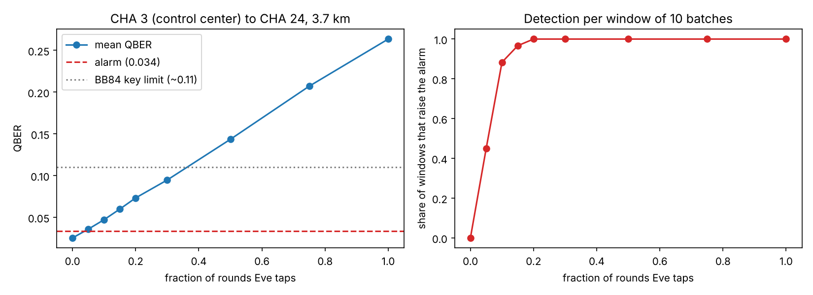

On qBraid, a quiet batch and a fully tapped batch were run on the QIR simulator and on IonQ's simulator. The quiet batch gave 0.000 on both, and the tapped batch gave 0.419 and 0.425. These are above the 0.25 average because only 6 rounds survived sifting and Eve guessed wrong on about 5 of them.

**Attacks on quantum backends.** `3f_attacks_on_hardware.ipynb` turns five attacks into one circuit each, with Alice's bits and bases from a quantum random number generator. Results on IonQ's noisy simulator and Quantinuum's H2 emulator:

| Attack | QBER (IonQ / H2) | Click yield | Caught by |
|---|---|---|---|
| None | 0.000 / 0.001 | 100% | – |
| Tap 3 of 12 rounds | 0.117 / 0.125 | 100% | QBER, near the 11% abort line |
| Tap every round | 0.242 / 0.259 | 100% | QBER |
| Detector blinding | 0.000 / 0.000 | 50% | Only a click-rate monitor |
| Scrambling (DoS) | 0.874 / 0.875 | 100% | QBER; the link falls back to PQC |

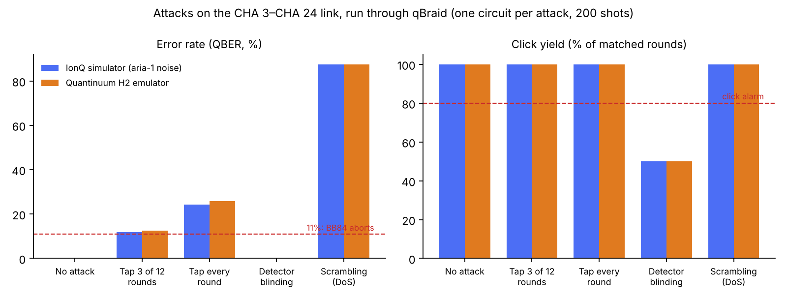

Blinding is the attack that QBER alone misses, the same weakness used against commercial systems in 2010 (Step 1). A detector-side check (click-rate monitoring) is what catches it. With 12 rounds only 4 survived sifting, so these numbers show which alarm fires, not precise rates.

**On real hardware (IonQ Forte 1, through qBraid and Open Quantum).** The full tap and the partial tap were run on Forte with a new key from the quantum random number generator. The full tap gave a QBER of 0.171 and the partial tap 0.085. Scored as detector blinding, the tap job kept QBER at 0.003 while the click yield fell to 67%. A noise-free simulation of the same key predicts 0.167, 0.084 and 0.000, so the hardware matched the physics to within half a percentage point. Every alarm decision came out the same as on the simulators. The full-tap figure is below 25% because, for this key, Eve happened to pick the right basis on 4 of the 6 sifted rounds.

**Whole design on qBraid's GPU simulator (3h).** BB84 was then run on all 8 QKD links of the final design at once: 3 sifted rounds per link plus an eavesdropper on the busiest link (CHA 11–CHA 27), 27 qubits in one circuit, 500 shots on `qbraid:qbraid:sim:gpu-sv`, about one second. The seven quiet links all read QBER 0.000, so their keys match. The tapped link read 0.331 against an expected 0.333 (Eve guessed the wrong basis on 2 of its 3 rounds), and only that link tripped the 11% alarm. This checks the design as a whole, not just one link: every link the optimizer chose produces a key, and the alarm points at the right cable.

**Teleportation link (Option B).** The teleportation circuit in `3_secure_grid_link.ipynb` sent qubit 0's state to qubit 2. It read back correctly on 1,024 of 1,024 local shots and on 195 of 200 shots on IonQ's noisy simulator. All three qubits are on one chip, so this shows the logic works, not that it works over distance. It is included because teleportation is how a quantum repeater would pass keys along without the trusted nodes described in Part 1.

## Step 3, Part 4: Rollout Plan

1. **Year 1.** Inventory all RSA and elliptic-curve use and switch firmware signing first, since a forged update does the most damage. Put PQC on the control centers and VPNs. Require crypto-agility and PQC support in every new purchase. Build the 4 backup routes, which fix the single-cut weak spots no matter what happens with QKD.
2. **Years 1–3.** Roll PQC out to all 65 links, one branch at a time, with gateways for old devices. Add classical fiber monitoring on the busiest links, where most taps would land. Pilot QKD on the three-hop control-center chain (CHA 3–24–12–11), the route shape EPB has already tested. Require detector-blinding countermeasures from the vendor.
3. **Years 3–7.** If the pilot runs reliably in substation conditions, extend QKD to the remaining chosen links and secure the trusted nodes. Replace equipment that cannot run PQC before NIST's 2030 deprecation date. Revisit trusted nodes when repeaters or MDI-QKD become commercial.

The order puts first what protects every link and fixes availability, and last the part that needs special hardware and still has to be proven in the field.

## Step 3, Part 5: Cost vs Security

| Option | What it costs | What it protects | What is still exposed |
|---|---|---|---|
| Keep what they have | Nothing new | Attackers today | Recorded traffic and firmware signing once RSA falls; misses NIST's 2030/2035 dates |
| PQC on all 65 links + 4 backup routes | Software and firmware updates, gateways for old devices, 4 new fiber routes | All links against "harvest now, decrypt later"; single fiber cuts | No physical tap alarm; depends on the PQC math holding |
| Design above: PQC + QKD on 8 links | The above, plus 8 QKD pairs, 4 secured trusted nodes, fiber monitoring | Keys for 317 MW even if PQC breaks; worst single tap cut from 641 to 336 MW | Trusted nodes; 91% of fiber relies on classical monitoring; two cuts at once |

QKD vendors do not publish prices. The only public figure found was $150,000–200,000 per link pair in 2009 (arXiv:0905.4325), so any total for the QKD part would be a guess, and none is given. The choice for the board does not depend on that number. PQC on every link plus backup routes is the required minimum: it matches NSA and NCSC advice and closes the biggest exposures. The 8 QKD links are an add-on for the links where a broken algorithm or an undetected tap would hurt most, and should be bought after the pilot proves out and a vendor quotes a price.

## Step 3, Stretch: QAOA vs Classical

The link choice was written as a QUBO, with one qubit per candidate link and a fixed budget, and solved with QAOA (`3e_qaoa_vs_classical.ipynb`). On the 10-qubit Chattanooga instance, the standard penalty version found the best plan in 0.24% of shots at p = 1. That is worse than picking random plans within budget (0.40%), because most of its probability went to plans over budget. A version whose mixer keeps the number of links fixed (XY mixer) reached 1.7% at p = 3. The exact solver and greedy both found the best plan every time, in about 0.01 s. One layer of standard QAOA compiles to 106 two-qubit gates, too deep for today's hardware. Run through qBraid with 1,000 shots, the p = 1 circuit returned a within-budget plan in 58% of shots on the QIR simulator and 52% on IonQ's noisy simulator, and the optimal plan in 0.10% on both. Noise did not change the outcome much, because even noise-free, the circuit rarely lands on the answer.

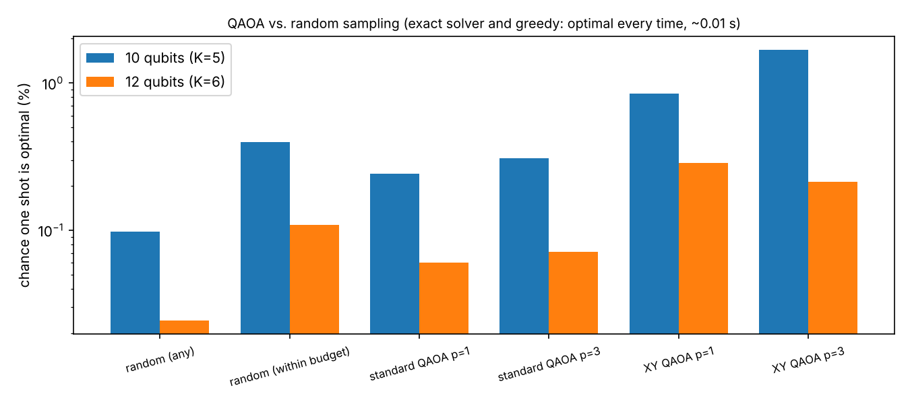

Repeated on 19 networks (6 to 14 qubits), the standard version did worse than random on all 19. The XY version beat random on 17, by a median of 3 times. The exact solver remained optimal on every one. The conclusion: the quantum part of this design belongs on the fiber (BB84), and the planning stays classical.

## Step 3, Stretch: Beyond BB84 (E91, Six-State, Entanglement Swapping)

Three protocol upgrades were built and run on qBraid's GPU simulator (`3j_e91_sixstate_swapping.ipynb`, 2,000 shots each). Each one was checked against a number theory gives in advance. The same circuits were also run locally with a noise model set to IonQ Forte's published gate and readout fidelities, to see how much margin survives real hardware noise. Those noisy runs are a local estimate, not a qBraid job.

**E91 (entanglement and a Bell test).** Alice and Bob share entangled pairs and measure them at four angle settings. The CHSH score *S* combines their four correlations. Perfect entanglement gives 2√2 ≈ 2.83. Any signal an eavesdropper has measured and resent can reach at most 2, so the test needs no key bits to be compared.

| Case | *S* on qBraid (GPU) | *S* with Forte-like noise (local) | Verdict |
|---|---|---|---|
| No eavesdropper | 2.78 | 2.77 | Entangled, secure |
| Full tap (Eve copies each qubit) | 1.40 | 1.37 | Caught: below 2 |
| Detector blinding, clicked rounds only | 2.83 | 2.73 | **Fooled** |
| Detector blinding, no-click rounds counted | 1.45 | 1.37 | Caught: below 2 |

Blinding is the attack that BB84 missed on Forte (QBER 0.003, Step 3 Part 3). It fools a Bell test as well, unless the rounds where Bob's detector stays silent are counted. Bob gets no click on half the rounds, and records a fixed value for each one. Counting those rounds drops *S* to 1.45, well below 2. In both protocols, blinding gives itself away through missing clicks, so the alarm has to track the click yield as well as the error rate. In E91 the missing clicks show up in the main security number itself. In the blinding run, Eve's copy matched Bob's bit on 100% of rounds, so a blinding attacker who goes unseen reads the whole key.

**Six-state QKD.** This is BB84 with a third basis. Twelve sifted rounds were run per protocol under a full intercept-resend tap. Eve's basis differed from Alice's on 8 of the 12 six-state rounds and on 6 of the 12 BB84 rounds, the share expected from random guessing.

| Protocol | Quiet QBER | Tapped QBER (qBraid) | Expected | With Forte-like noise (local) |
|---|---|---|---|---|
| Six-state | 0.000 | **0.329** | 0.333 | 0.336 |
| BB84 | 0.000 (3h) | 0.253 | 0.250 | 0.254 |

The same tap raises six-state's error rate to three times the 11% alarm, against about twice for BB84, so a partial tap is caught with fewer rounds. The cost is a lower key rate: Alice and Bob pick the same basis 1/3 of the time instead of 1/2, so more rounds are discarded.

**Entanglement swapping (replacing trusted relays).** In the design so far, each relay holds the key in the clear (a trusted node). With swapping, the relay instead holds one half of an Alice–relay pair and one half of a relay–Bob pair. A Bell measurement on its two halves leaves Alice and Bob entangled with each other, and the relay never sees the key.

| Chain | *S* on qBraid (GPU) | *S* with Forte-like noise (local) |
|---|---|---|
| Alice – relay – Bob | 2.80 | 2.69 |
| Alice – relay – relay – Bob | 2.86 | 2.65 |

A separate 4-qubit run recorded what the relay sees. Alice's and Bob's bits agreed on 100% of 2,000 shots, while the relay's own outcomes were spread evenly over its four results. Those outcomes carry 0.001 bits of information about each key bit, which is zero within sampling error. A hacked swapping relay therefore has nothing to leak, which removes the trusted-node risk that Part 2 and M6 (key splitting) worked around.

The 2-relay value above 2.83 is sampling noise: each *S* has a standard error of about 0.03 at 2,000 shots. With Forte-like gate noise, each relay costs about 0.04 to 0.08 in *S*, which leaves room for roughly ten relays before *S* reaches 2. Real links are limited by fiber loss and quantum memory, not by gate noise. Swapping over metro fiber still needs quantum memories that are not yet field-ready, so this is the path for later phases of the rollout (Part 4), not phase 1.

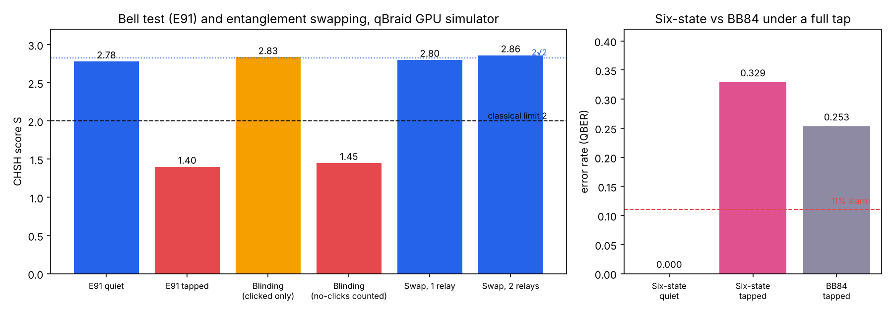

## Step 3, Interactive Tool: L.A.R.P (Linear Algorithm for Resilient Power)

`qkd_grid_optimizer.html` (L.A.R.P) packages the design method as a page anyone can use without running code (`qkd_grid_optimizer_1280x720.html` is a fixed-size copy for slides). It covers:

- **Inputs:**
  - Load one of the 8 example grids.
  - Upload a JSON grid; nodes with `lat`/`lon` are drawn on OpenStreetMap's standard tiles, with Wikimedia's OpenStreetMap tiles as an automatic fallback (neither needs a key). A built-in map (Natural Earth and US Census data: highways, rivers, lakes, county and state lines, towns) sits underneath, so the page still shows a map offline.
  - Trace a picture of a grid, or have qBraid's AI Gateway read it.
- **Assumptions:** sliders for the QKD budget, hop limit, fiber loss and loss limit, a security level (number of trusted nodes) and an optimization goal. A sector switch (power, water, pipeline, hospital, bank) relabels values and loads that sector's starting assumptions.
- **Results:**
  - The optimized map, plus the share of control traffic that crosses a QKD (tap-alarmed) cable, the worst-wiretap cut, the load with QKD on every hop, key hubs, minimum key rate and the control-center QKD path. Every cable keeps post-quantum encryption.
  - A checklist of design checks, including whether the result matches the exact integer program. For the presets at default settings, it matches on 7 of 8 networks and is within 2.6% on Memphis.
- **Link failures:** a *Survive 1 QKD link failure* option plans spare QKD routes, and the checklist reports how much quantum-safe load remains if the worst QKD link fails. *Cut fiber* mode cuts any link to show what remains. In Chattanooga with 12 QKD links, the option raises the share kept after the worst failure from 60% to 76% (Knoxville: 46% to 77%). The cost is less load protected while every link is up (32.7% to 27.1%). With only 8 links there is no budget left for spare routes, and the design does not change.
- **Attacks:** clicking a link taps it. On a QKD link the alarm fires with an error rate measured on qBraid (IonQ Forte 1, IonQ simulator or Quantinuum H2). On a PQC-only link the tap goes unseen.
- **Export:** *Download design JSON* feeds `3h_design_on_qbraid.ipynb`.

The page runs a fast greedy-plus-local-search solver in the browser, checked against the notebooks' exact solver. The five city presets sit on the real map: each substation is placed at its real town, and positions within a town are schematic, scaled so in-town lines match their length.

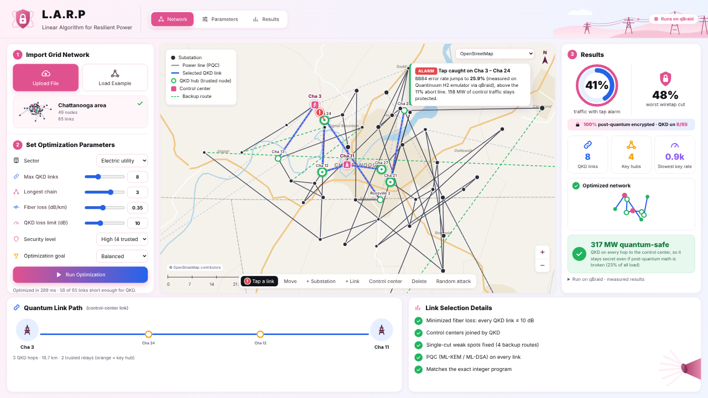

## Step 3, Methods: How the Design Was Built and Tested

### M1. Networks

The Chattanooga network was cut from ACTIVSg70k with a parser for the MATPOWER file (`network_design/parse_mp.py`, `extract_chattanooga.py`). Buses sharing a substation name were merged, and line reactance was converted to km using typical ohms per km for each voltage. To test whether the method transfers, the same extraction was run on 6 cities (Chattanooga, Knoxville, Nashville, Memphis, Atlanta, Huntsville) at 1–4 neighborhood radii, plus the IEEE 14-, 30-, 57-, 118- and 300-bus test cases (`extract_region.py`, `extract_ieee.py`). That makes 21 networks of 11 to 204 substations.

### M2. Design versions

| Version | Change | Why |
|---|---|---|
| v0 (`3b`) | Hand-made rule: join control centers, then add the highest-voltage, highest-load substations | First draft. More budget sometimes gave less protection. |
| v1 (`3c`) | Exact integer program. Value = MW × chance of a tap × chance of detection, discounted per trusted node | Guarantees the best plan for each budget |
| v1.1 | Value simplified to MW × route length | The Sobol screen (M4) showed the extra parameters barely changed the design |
| v1.2 (`3g`) | Adds a tap-detection term for traffic on each QKD link | Attack tests (M5) showed the secrecy-only design left the busiest fiber unwatched. The worst single tap fell from 593 to 336 MW for 7% less secrecy. |

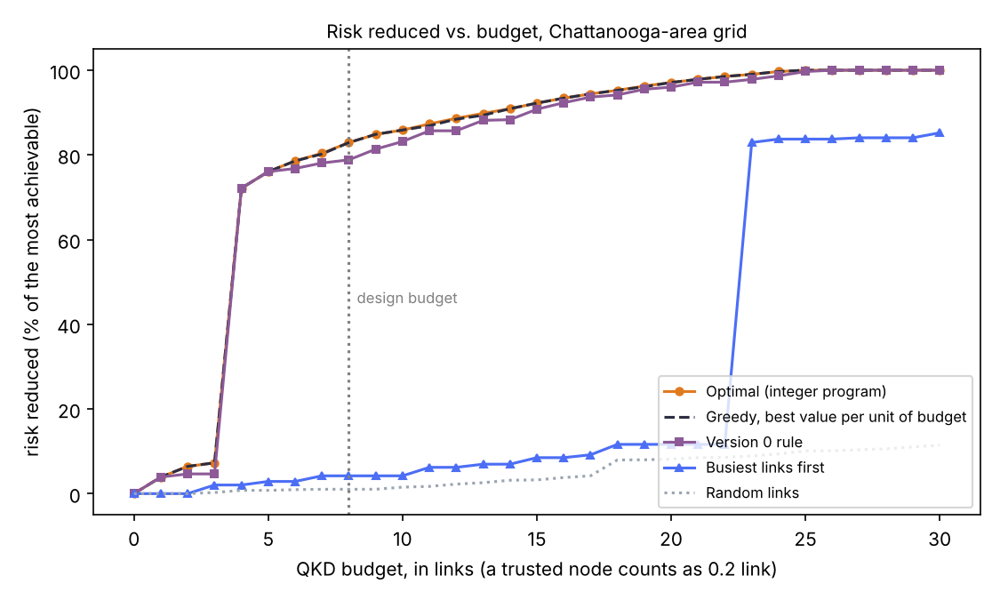

The budget chart shows why the hand rule was replaced. The exact solver never drops as the budget grows. The v0 rule fell up to 36% short at some budgets. The big jump at 4 links is the three-hop chain joining the control centers.

### M3. Optimization methods compared

Eight methods were run on 192 cases: 16 networks × 3 hop limits × 4 budgets. The methods were the exact integer program (SciPy HiGHS), LP relaxation with rounding, greedy, greedy with local search, simulated annealing, a genetic algorithm, busiest links first, and random links. The exact program was optimal in 100% of cases, averaging 1.9 s and taking at most 28 s. The best heuristics were optimal in about 47% of cases and within 2% on average, but up to 20% short in the worst case. Busiest-links-first, the intuitive rule, was 74% short on average.

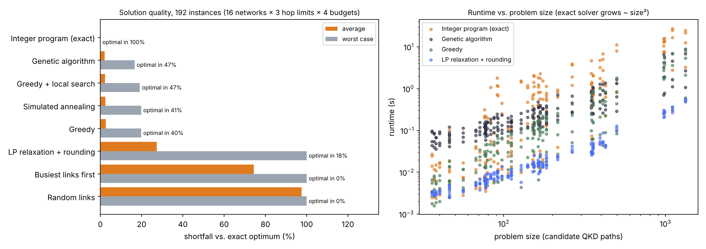

### M4. Sensitivity

**Sobol.** Eleven parameters were varied together over their plausible ranges: fiber loss, loss limit, hop limit, tap rate, detection chance, trusted-node risk, cost weights, and how exposure scales with route length and MW. For each run, the output was which links got QKD (`network_design/sobol_screen.py`, 256 base samples per city). The longest allowed chain had the largest total effect in all three cities (0.51–0.68). Detection chance and trusted-node risk had little effect (0.12 or less), so they were dropped in v1.1.

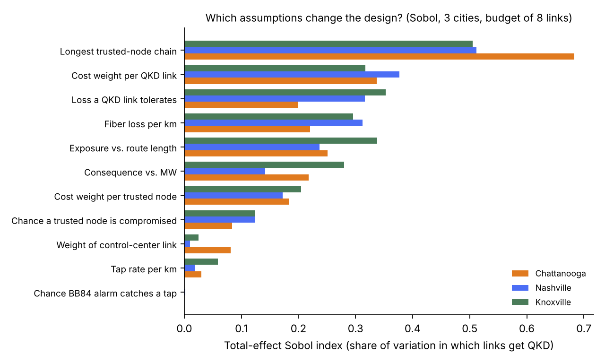

**SMAA.** The v1 design was re-solved 400 times with uncertain values drawn at random. Four links were chosen in every draw: the control-center chain and CHA 3–Rossville 2. These are the safest first purchases, because they don't depend on the uncertain numbers.

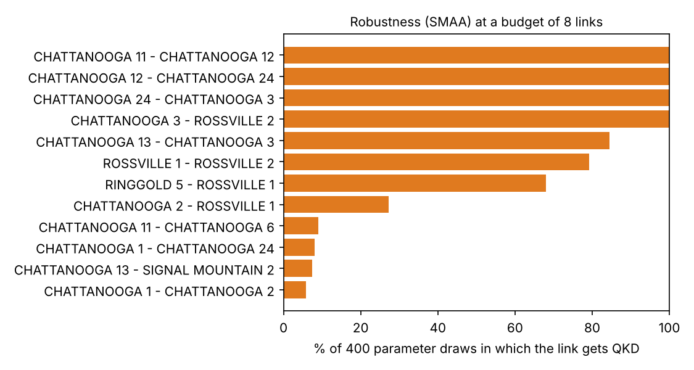

### M5. Attack tests

Each design was attacked in simulation (`network_design/attacks.py`, `attacks2.py`) on all 21 networks at three budgets (4/2, 8/4 and 16/8 links/trusted nodes). It was compared with PQC only, busiest-links-first, and the secrecy-only v1.1 design.

| Attack | Model | Result (median over networks, 8 links) |
|---|---|---|
| Single tap | Eve taps each link in turn; caught only if that link has QKD | Balanced design cuts the worst tap by 47% |
| Random taps | Taps land on fiber in proportion to length | 9% land on QKD fiber |
| Trusted-node compromise | Worst 1 or 2 nodes taken over | Key splitting lowers the loss (Chattanooga: 186 → 138 MW for 2 nodes) |
| Detector blinding | Worst QKD link's detectors controlled | 46% of load exposed without a countermeasure, 5% with |
| Denial of service | Worst 1–2 QKD links jammed | Secrecy lost on that load, 0 MW of service lost (PQC fallback) |
| Fiber cuts | Worst 1 or 2 cuts, with re-planning | 1 cut: 5% → 0% after backup routes; 2 cuts: 10% → 7% |

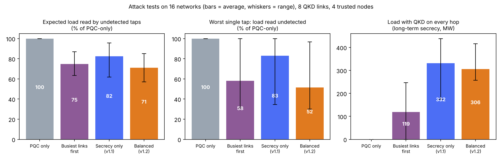

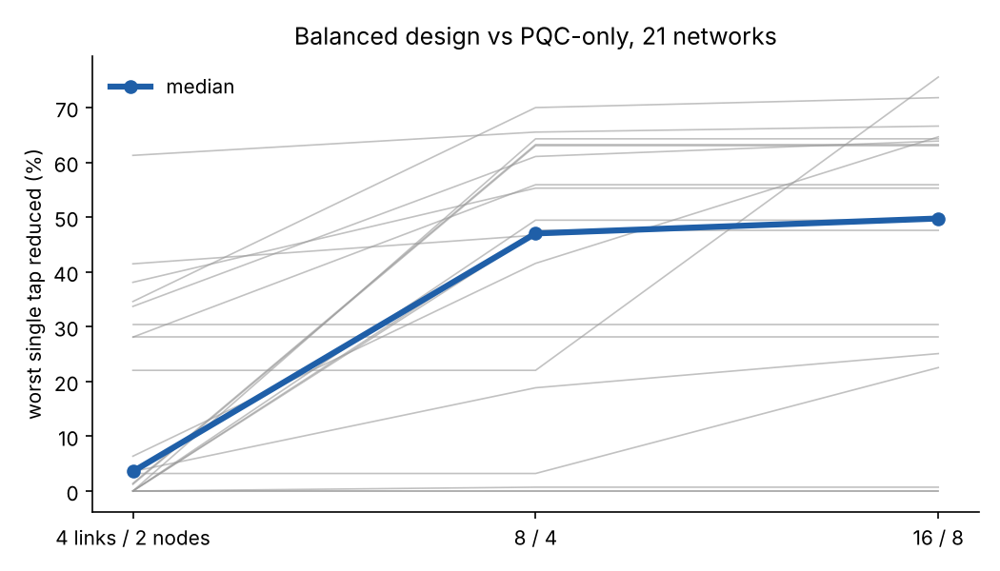

### M6. Resilience

**Key splitting.** Each key is split into two shares sent over node-disjoint QKD routes, so one compromised trusted node learns nothing (`resilience.py`). It helps only where a second QKD route fits the budget: one substation in Chattanooga, more on larger grids.

**Backup routes.** The fiber graph was searched for bridges, links whose cut isolates part of the network. Backup links were added between the farthest-apart dead ends until no bridge remained. This used the minimum possible number of new links on every network, which is 4 in Chattanooga (251 km of new PQC fiber, estimated along existing routes).

### M7. Alarm design

`3d_alarm_threshold.ipynb` checked how small a tap a QBER alarm can catch. With a fixed threshold, the smallest catchable tap shrinks with the window size: 61% at 60 sifted rounds, 11% at 1,000 and 1.3% at 64,000. Real links send thousands of rounds per second, so small taps become catchable in seconds.

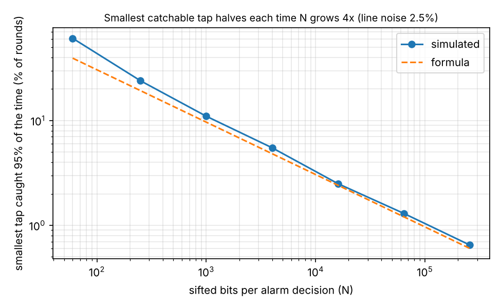

Three detectors were compared at equal false-alarm rates: a fixed threshold, a Kalman filter tracking slow drift in line noise, and a Kalman filter followed by a CUSUM change test. For a 1% tap, Kalman + CUSUM caught 50% of cases against 6% for the fixed threshold. Under weather-like noise gusts, Kalman + CUSUM raised fewer false alarms than Kalman alone (2.8 vs 5.4 per 1,000 windows) while catching the most taps.

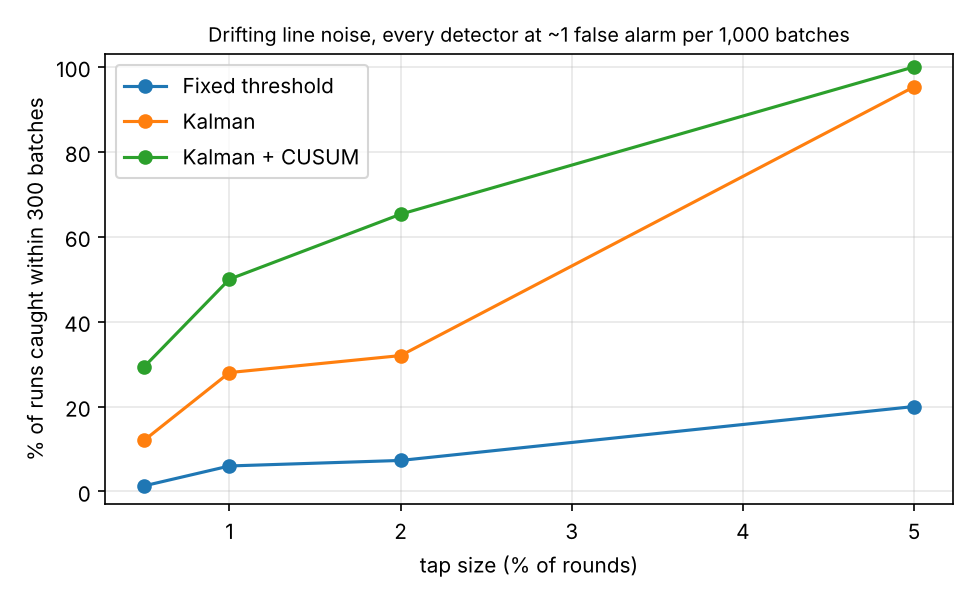

Fusing the QBER alarm with a classical fiber monitor (OTDR/vibration) caught 84% of 2% taps, against 56% for QBER alone and 55% for the monitor alone, with fewer false alarms. Against a careful attacker the monitor cannot see, the fused alarm still caught 68%, because the QBER half keeps working.

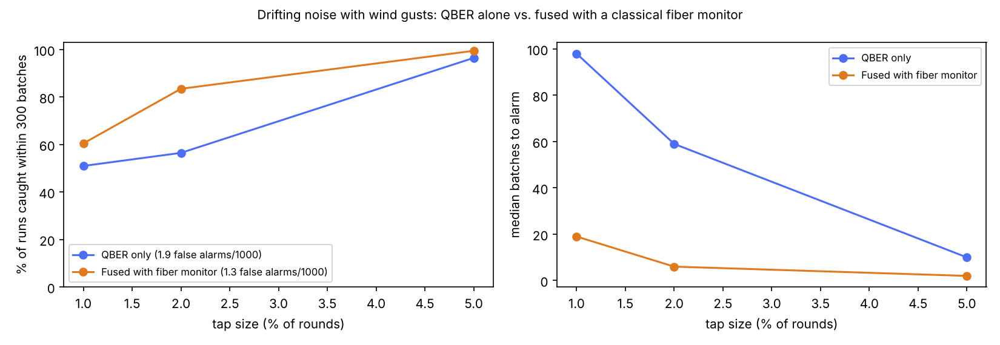

### M8. Classical and quantum parts

| Part of the system | Method | Classical or quantum | Compared against |
|---|---|---|---|
| Key exchange on chosen links | BB84 | Quantum | PQC (ML-KEM) on every link |
| Tap detection | QBER from BB84 | Quantum | Classical fiber monitoring; fused alarm best |
| Randomness for BB84 | QRNG (H + measure) | Quantum | Seeded software generator |
| Choosing QKD links | Integer program | Classical | QAOA (standard and XY) on 19 networks |
| Alarm decision | Kalman + CUSUM | Classical | Fixed threshold |
| Backup routes, key splitting | Graph algorithms | Classical | No backup / single route |
| Bell-test key exchange | E91 (CHSH) | Quantum | BB84 QBER |
| Three-basis key exchange | Six-state | Quantum | BB84 |
| Relays without key access | Entanglement swapping | Quantum | Trusted relays |
| Surviving a QKD link failure | N-1 search in L.A.R.P | Classical | Design without spare routes |

### Limitations

- The grid is synthetic, the fiber is assumed to follow the power lines, and the control centers are proxies.
- Line noise is modeled as a bit flip at Bob's detector, not as fiber loss.
- The attack circuits use 12 rounds, so the rates are rough. Detector blinding is modeled in post-processing, not in hardware.
- The E91, six-state and swapping runs are noise-free simulations. Their noisy figures come from a local noise model approximating IonQ Forte's published fidelities, not from qBraid hardware.
- No QKD prices were available.
- Sobol was completed for 3 of the 6 cities.

Sources:

- A. Birchfield et al., "Grid Structural Characteristics as Validation Criteria for Synthetic Networks," IEEE Trans. Power Systems, 2017; ACTIVSg70k case via MATPOWER.
- P. Evans et al., "Trusted Node QKD at an Electrical Utility," IEEE Access, 2021. https://arxiv.org/abs/2103.09877
- arXiv:0905.4325 (2009 QKD system price).
- NIST FIPS 203, FIPS 204; NIST IR 8547.
- L. Lydersen et al., 2010 (detector blinding), cited in Step 1.

# Run Record

Every cloud run, labeled simulator, emulator or QPU, including the ones that failed. Runs on the local Aer simulator have no job ID and are not listed.

| Part | Run | Device | Type | Job ID | Shots | Status | Result |
|---|---|---|---|---|---|---|---|
| Step 1, Part 3 | BB84, 16 rounds in one circuit | IonQ simulator | Simulator | `ionq:ionq:sim:simulator-b095-qjob-6af88876c8f5265fb3f1bd01` | 200 | Completed | QBER 0.001 |
| Step 1, Part 3 | BB84, 16 rounds in one circuit | IonQ Forte 1 (Open Quantum) | QPU | `openquantum:ionq:qpu:forte-1-b095-qjob-6af88c54c8f5265fb3f1bdde` | 200 | Completed | QBER 0.004 |
| Step 1, Part 3 | BB84, 16 rounds in one circuit | IonQ Forte 1 (Open Quantum) | QPU | `openquantum:ionq:qpu:forte-1-b095-qjob-6af88b54c8f5265fb3f1bdaa` | 200 | Failed | Rejected before running: the circuit left one qubit unused |
| Step 1, Part 3 | BB84, 16 rounds in one circuit | IonQ Forte 1 (Open Quantum) | QPU | `openquantum:ionq:qpu:forte-1-b095-qjob-6af88ac6c8f5265fb3f1bd8d` | 200 | Failed | Open Quantum terms not accepted yet |
| Step 1, Part 3 | BB84, 16 rounds in one circuit | IonQ Forte 1 (Open Quantum) | QPU | `openquantum:ionq:qpu:forte-1-b095-qjob-6af88a4bc8f5265fb3f1bd6e` | 200 | Failed | Open Quantum terms not accepted yet |
| Step 1, Part 3 | BB84, 16 rounds in one circuit | IonQ Forte 1 (Open Quantum) | QPU | `openquantum:ionq:qpu:forte-1-b095-qjob-6af8896cc8f5265fb3f1bd3a` | 200 | Failed | Open Quantum account not connected yet |
| Step 1, Part 3 | BB84, earlier practice run | IonQ simulator | Simulator | `ionq:ionq:sim:simulator-b095-qjob-6af7c852f15852ed27b72101` | 200 | Completed | Not used in the write-up |
| Step 1, Part 3 | BB84, earlier practice run | IonQ simulator | Simulator | `ionq:ionq:sim:simulator-b095-qjob-6af7c842f15852ed27b720fa` | 200 | Completed | Not used in the write-up |
| Step 2, Part 5 | Grover, N=4 | IonQ simulator (forte-1 noise model) | Simulator | `ionq:ionq:sim:simulator-0ad7-qjob-6af7e58ef15852ed27b72b26` | 200 | Completed | 200/200 on key (100%) |
| Step 2, Part 5 | Grover, N=8 | IonQ simulator (forte-1 noise model) | Simulator | `ionq:ionq:sim:simulator-0ad7-qjob-6af86a41c8f5265fb3f1b033` | 200 | Completed | 158/200 on key (79%) |
| Step 2, Part 5 | Grover, N=16 | IonQ simulator (forte-1 noise model) | Simulator | `ionq:ionq:sim:simulator-0ad7-qjob-6af7e25ef15852ed27b72a6b` | 200 | Completed | 87/200 on key (44%) |
| Step 2, Part 5 | Grover, N=16 | Quantinuum H2 emulator | Emulator | `quantinuum:quantinuum:sim:h2-emulator-0ad7-qjob-6af86c52c8f5265fb3f1b0ee` | 200 | Completed | 165/200 on key (82.5%) |
| Step 3, Part 3 | Teleportation link | IonQ simulator (forte-1 noise model) | Simulator | `ionq:ionq:sim:simulator-b095-qjob-6af89604c8f5265fb3f1cbf3` | 200 | Completed | Qubit 2 read 0 on 195/200 |
| Step 3, Part 3 | Teleportation link, earlier run | IonQ simulator (forte-1 noise model) | Simulator | `ionq:ionq:sim:simulator-b095-qjob-6af7d2bdf15852ed27b723ed` | 200 | Completed | Qubit 2 read 0 on 197/200 |
| Step 3, Part 3 | Teleportation link, earlier run | IonQ simulator (forte-1 noise model) | Simulator | `ionq:ionq:sim:simulator-b095-qjob-6af7d2b7f15852ed27b723df` | 200 | Completed | Not used in the write-up |
| Step 3, Part 3 | Teleportation link, earlier run | IonQ simulator (forte-1 noise model) | Simulator | `ionq:ionq:sim:simulator-b095-qjob-6af7d2a7f15852ed27b723d5` | 200 | Completed | Not used in the write-up |
| Step 3, Part 3 | BB84 grid link CHA 3–CHA 24 (3a), quiet batch | QIR simulator | Simulator | `qbraid:qbraid:sim:qir-sv-91f5-qjob-6af88c8ac8f5265fb3f1bdf0` | 200 | Completed | QBER 0.000 |
| Step 3, Part 3 | BB84 grid link CHA 3–CHA 24 (3a), fully tapped batch | QIR simulator | Simulator | `qbraid:qbraid:sim:qir-sv-91f5-qjob-6af88ca6c8f5265fb3f1be06` | 200 | Completed | QBER 0.419 |
| Step 3, Part 3 | BB84 grid link CHA 3–CHA 24 (3a), quiet batch | IonQ simulator (aria-1 noise) | Simulator | `ionq:ionq:sim:simulator-91f5-qjob-6af88c95c8f5265fb3f1bdf8` | 200 | Completed | QBER 0.000 |
| Step 3, Part 3 | BB84 grid link CHA 3–CHA 24 (3a), fully tapped batch | IonQ simulator (aria-1 noise) | Simulator | `ionq:ionq:sim:simulator-91f5-qjob-6af88cb6c8f5265fb3f1be0c` | 200 | Completed | QBER 0.425 |
| Step 3, Part 3 | BB84 grid link (3a), rerun | QIR simulator | Simulator | `qbraid:qbraid:sim:qir-sv-91f5-qjob-6af8f6a3c8f5265fb3f21786` | 200 | Completed | Rerun of the same notebook; the first run above is reported |
| Step 3, Part 3 | BB84 grid link (3a), rerun | IonQ simulator (aria-1 noise) | Simulator | `ionq:ionq:sim:simulator-91f5-qjob-6af8f6afc8f5265fb3f2178e` | 200 | Completed | Rerun of the same notebook; the first run above is reported |
| Step 3, Part 3 | BB84 grid link (3a), rerun | QIR simulator | Simulator | `qbraid:qbraid:sim:qir-sv-91f5-qjob-6af8f6c0c8f5265fb3f2179e` | 200 | Completed | Rerun of the same notebook; the first run above is reported |
| Step 3, Part 3 | BB84 grid link (3a), rerun | IonQ simulator (aria-1 noise) | Simulator | `ionq:ionq:sim:simulator-91f5-qjob-6af8f6ccc8f5265fb3f217a4` | 200 | Completed | Rerun of the same notebook; the first run above is reported |
| Step 3, Part 3 | QRNG bits (3f, first key, submitted via qBraid MCP) | QIR simulator | Simulator | `qbraid:qbraid:sim:qir-sv-91f5-qjob-6af8e4a7c8f5265fb3f21089` | 3 | Completed | 36 random bits |
| Step 3, Part 3 | Attack test: none (3f, first key, submitted via qBraid MCP) | QIR simulator | Simulator | `qbraid:qbraid:sim:qir-sv-91f5-qjob-6af8e4aac8f5265fb3f2108d` | 200 | Completed | QBER 0.000 |
| Step 3, Part 3 | Attack test: tap every round; also scored as blinding (3f, first key, submitted via qBraid MCP) | QIR simulator | Simulator | `qbraid:qbraid:sim:qir-sv-91f5-qjob-6af8e4aec8f5265fb3f21092` | 200 | Completed | Tap QBER 0.353; blinding QBER 0.000, click yield 29% |
| Step 3, Part 3 | Attack test: tap 3 of 12 rounds (3f, first key, submitted via qBraid MCP) | QIR simulator | Simulator | `qbraid:qbraid:sim:qir-sv-91f5-qjob-6af8e4b2c8f5265fb3f2109e` | 200 | Completed | QBER 0.082 |
| Step 3, Part 3 | Attack test: scrambling (DoS) (3f, first key, submitted via qBraid MCP) | QIR simulator | Simulator | `qbraid:qbraid:sim:qir-sv-91f5-qjob-6af8e4b7c8f5265fb3f210a6` | 200 | Completed | QBER 0.789 |
| Step 3, Part 3 | Attack test: tap every round (3f, first key, via qBraid MCP) | IonQ simulator (no noise model) | Simulator | `ionq:ionq:sim:simulator-91f5-qjob-6af8e4bbc8f5265fb3f210ab` | 200 | Completed | Returned probabilities, not shots; not scored |
| Step 3, Part 3 | Attack tests (3f), earlier partial runs | QIR simulator | Simulator | `qbraid:qbraid:sim:qir-sv-91f5-qjob-6af8fb51c8f5265fb3f21a94` | 3 | Completed | Superseded by the final run below; not used |
| Step 3, Part 3 | Attack tests (3f), earlier partial runs | QIR simulator | Simulator | `qbraid:qbraid:sim:qir-sv-91f5-qjob-6af8fb72c8f5265fb3f21aaf` | 200 | Completed | Superseded by the final run below; not used |
| Step 3, Part 3 | Attack tests (3f), earlier partial runs | QIR simulator | Simulator | `qbraid:qbraid:sim:qir-sv-91f5-qjob-6af8fb82c8f5265fb3f21abb` | 200 | Completed | Superseded by the final run below; not used |
| Step 3, Part 3 | Attack tests (3f), earlier partial runs | QIR simulator | Simulator | `qbraid:qbraid:sim:qir-sv-91f5-qjob-6af8fb8dc8f5265fb3f21ac7` | 200 | Completed | Superseded by the final run below; not used |
| Step 3, Part 3 | Attack tests (3f), earlier partial runs | QIR simulator | Simulator | `qbraid:qbraid:sim:qir-sv-91f5-qjob-6af8fb9dc8f5265fb3f21ad7` | 200 | Completed | Superseded by the final run below; not used |
| Step 3, Part 3 | Attack tests (3f), earlier partial runs | IonQ simulator (aria-1 noise) | Simulator | `ionq:ionq:sim:simulator-91f5-qjob-6af8fba9c8f5265fb3f21add` | 200 | Completed | Superseded by the final run below; not used |
| Step 3, Part 3 | Attack tests (3f), earlier partial runs | QIR simulator | Simulator | `qbraid:qbraid:sim:qir-sv-91f5-qjob-6af8fbafc8f5265fb3f21ae7` | 3 | Completed | Superseded by the final run below; not used |
| Step 3, Part 3 | Attack tests (3f), earlier partial runs | QIR simulator | Simulator | `qbraid:qbraid:sim:qir-sv-91f5-qjob-6af8fbbfc8f5265fb3f21aef` | 200 | Completed | Superseded by the final run below; not used |
| Step 3, Part 3 | Attack tests (3f), earlier partial runs | QIR simulator | Simulator | `qbraid:qbraid:sim:qir-sv-91f5-qjob-6af8fbcac8f5265fb3f21af7` | 200 | Completed | Superseded by the final run below; not used |
| Step 3, Part 3 | Attack tests (3f), earlier partial runs | QIR simulator | Simulator | `qbraid:qbraid:sim:qir-sv-91f5-qjob-6af8fbdac8f5265fb3f21b13` | 200 | Completed | Superseded by the final run below; not used |
| Step 3, Part 3 | Attack tests (3f), earlier partial runs | QIR simulator | Simulator | `qbraid:qbraid:sim:qir-sv-91f5-qjob-6af8fbe5c8f5265fb3f21b1b` | 200 | Completed | Superseded by the final run below; not used |
| Step 3, Part 3 | Attack tests (3f), earlier partial runs | IonQ simulator (aria-1 noise) | Simulator | `ionq:ionq:sim:simulator-91f5-qjob-6af8fbf6c8f5265fb3f21b42` | 200 | Completed | Superseded by the final run below; not used |
| Step 3, Part 3 | Attack tests (3f), earlier partial runs | IonQ simulator (aria-1 noise) | Simulator | `ionq:ionq:sim:simulator-91f5-qjob-6af8fc06c8f5265fb3f21b4a` | 200 | Completed | Superseded by the final run below; not used |
| Step 3, Part 3 | Attack tests (3f), earlier partial runs | IonQ simulator (aria-1 noise) | Simulator | `ionq:ionq:sim:simulator-91f5-qjob-6af8fc44c8f5265fb3f21b7e` | 200 | Completed | Superseded by the final run below; not used |
| Step 3, Part 3 | Attack tests (3f), earlier partial runs | IonQ simulator (aria-1 noise) | Simulator | `ionq:ionq:sim:simulator-91f5-qjob-6af8fc64c8f5265fb3f21b8b` | 200 | Completed | Superseded by the final run below; not used |
| Step 3, Part 3 | Attack tests (3f), earlier partial runs | Quantinuum H2 emulator | Emulator | `quantinuum:quantinuum:sim:h2-emulator-91f5-qjob-6af8fc93c8f5265fb3f21b9e` | 200 | Completed | Superseded by the final run below; not used |
| Step 3, Part 3 | QRNG bits (final key) (3f, final run) | QIR simulator | Simulator | `qbraid:qbraid:sim:qir-sv-91f5-qjob-6af8fcafc8f5265fb3f21bb2` | 3 | Completed | 36 random bits |
| Step 3, Part 3 | Attack test: none (3f, final run) | QIR simulator | Simulator | `qbraid:qbraid:sim:qir-sv-91f5-qjob-6af8fcc4c8f5265fb3f21bd1` | 200 | Completed | Noise-free reference |
| Step 3, Part 3 | Attack test: tap every round (3f, final run) | QIR simulator | Simulator | `qbraid:qbraid:sim:qir-sv-91f5-qjob-6af8fcd0c8f5265fb3f21bd6` | 200 | Completed | Noise-free reference |
| Step 3, Part 3 | Attack test: tap 3 of 12 (3f, final run) | QIR simulator | Simulator | `qbraid:qbraid:sim:qir-sv-91f5-qjob-6af8fcdbc8f5265fb3f21be0` | 200 | Completed | Noise-free reference |
| Step 3, Part 3 | Attack test: DoS (3f, final run) | QIR simulator | Simulator | `qbraid:qbraid:sim:qir-sv-91f5-qjob-6af8fcebc8f5265fb3f21bea` | 200 | Completed | Noise-free reference |
| Step 3, Part 3 | Attack test: none (3f, final run) | IonQ simulator (aria-1 noise) | Simulator | `ionq:ionq:sim:simulator-91f5-qjob-6af8fcf6c8f5265fb3f21bf1` | 200 | Completed | QBER 0.000 |
| Step 3, Part 3 | Attack test: tap every round; also scored as blinding (3f, final run) | IonQ simulator (aria-1 noise) | Simulator | `ionq:ionq:sim:simulator-91f5-qjob-6af8fd07c8f5265fb3f21bfc` | 200 | Completed | Tap QBER 0.242; blinding QBER 0.000, yield 50% |
| Step 3, Part 3 | Attack test: tap 3 of 12 (3f, final run) | IonQ simulator (aria-1 noise) | Simulator | `ionq:ionq:sim:simulator-91f5-qjob-6af8fd17c8f5265fb3f21c04` | 200 | Completed | QBER 0.117 |
| Step 3, Part 3 | Attack test: DoS (3f, final run) | IonQ simulator (aria-1 noise) | Simulator | `ionq:ionq:sim:simulator-91f5-qjob-6af8fd27c8f5265fb3f21c10` | 200 | Completed | QBER 0.874 |
| Step 3, Part 3 | Attack test: none (3f, final run) | Quantinuum H2 emulator | Emulator | `quantinuum:quantinuum:sim:h2-emulator-91f5-qjob-6af8fd37c8f5265fb3f21c17` | 200 | Completed | QBER 0.001 |
| Step 3, Part 3 | Attack test: tap every round; also scored as blinding (3f, final run) | Quantinuum H2 emulator | Emulator | `quantinuum:quantinuum:sim:h2-emulator-91f5-qjob-6af8fd66c8f5265fb3f21c32` | 200 | Completed | Tap QBER 0.259; blinding QBER 0.000, yield 50% |
| Step 3, Part 3 | Attack test: tap 3 of 12 (3f, final run) | Quantinuum H2 emulator | Emulator | `quantinuum:quantinuum:sim:h2-emulator-91f5-qjob-6af8fe7ec8f5265fb3f21cad` | 200 | Completed | QBER 0.125 |
| Step 3, Part 3 | Attack test: DoS (3f, final run) | Quantinuum H2 emulator | Emulator | `quantinuum:quantinuum:sim:h2-emulator-91f5-qjob-6af8febcc8f5265fb3f21cc9` | 200 | Completed | QBER 0.875 |
| Step 3, Stretch | QAOA, 10 qubits, p = 1 (3e) | QIR simulator | Simulator | `qbraid:qbraid:sim:qir-sv-91f5-qjob-6af8fab9c8f5265fb3f21a35` | 1000 | Completed | Within budget 58%, optimal 0.10%, best 1.000 |
| Step 3, Stretch | QAOA, 10 qubits, p = 1 (3e) | IonQ simulator (aria-1 noise) | Simulator | `ionq:ionq:sim:simulator-91f5-qjob-6af8facec8f5265fb3f21a47` | 1000 | Completed | Within budget 52%, optimal 0.10%, best 1.000 |
| Step 3, Part 3 | Attack tests (3f) on real hardware | IonQ Forte 1 (Open Quantum) | QPU | `openquantum:ionq:qpu:forte-1-91f5-qjob-6af8fef0c8f5265fb3f21cdf` | 200 | Failed | Open Quantum account not linked yet |
| Step 3, Part 3 | Attack tests (3f) on real hardware | IonQ Forte 1 (Open Quantum) | QPU | `openquantum:ionq:qpu:forte-1-91f5-qjob-6af8fef6c8f5265fb3f21ce3` | 200 | Failed | Open Quantum account not linked yet |
| Step 3, Part 3 | Attack tests (3f) on real hardware | IonQ Forte 1 (Open Quantum) | QPU | `openquantum:ionq:qpu:forte-1-91f5-qjob-6af8fefcc8f5265fb3f21ceb` | 200 | Failed | Open Quantum account not linked yet |
| Step 3, Part 3 | Attack tests (3f) on real hardware | IonQ Forte 1 (Open Quantum) | QPU | `openquantum:ionq:qpu:forte-1-91f5-qjob-6af8ff08c8f5265fb3f21cfc` | 200 | Failed | Open Quantum account not linked yet |
| Step 3, Part 3 | Attack tests (3f) on real hardware | IonQ Forte 1 (Open Quantum) | QPU | `openquantum:ionq:qpu:forte-1-91f5-qjob-6af8ff10c8f5265fb3f21d04` | 200 | Failed | Open Quantum account not linked yet |
| Step 3, Part 3 | Attack tests (3f) on real hardware | IonQ Forte 1 (Open Quantum) | QPU | `openquantum:ionq:qpu:forte-1-91f5-qjob-6af90a0bc8f5265fb3f224d6` | 200 | Failed | Open Quantum account not linked yet |
| Step 3, Part 3 | Attack tests (3f) on real hardware | IonQ Forte 1 (Open Quantum) | QPU | `openquantum:ionq:qpu:forte-1-91f5-qjob-6af90a12c8f5265fb3f224f4` | 200 | Failed | Open Quantum account not linked yet |
| Step 3, Part 3 | Attack tests (3f) on real hardware | IonQ Forte 1 (Open Quantum) | QPU | `openquantum:ionq:qpu:forte-1-91f5-qjob-6af90a1ec8f5265fb3f22523` | 200 | Failed | Open Quantum account not linked yet |
| Step 3, Part 3 | Attack tests (3f) on real hardware | IonQ Forte 1 (Open Quantum) | QPU | `openquantum:ionq:qpu:forte-1-91f5-qjob-6af90a27c8f5265fb3f22546` | 200 | Failed | Open Quantum account not linked yet |
| Step 3, Part 3 | Attack tests (3f) on real hardware | IonQ Forte 1 (Open Quantum) | QPU | `openquantum:ionq:qpu:forte-1-91f5-qjob-6af90a2ec8f5265fb3f2255e` | 200 | Failed | Open Quantum account not linked yet |
| Step 3, Part 3 | Attack tests (3f) on real hardware | IonQ Forte 1 (Open Quantum) | QPU | `openquantum:ionq:qpu:forte-1-91f5-qjob-6af90abec8f5265fb3f225ad` | 200 | Cancelled | No-attack circuit; cancelled (duplicate, baseline already measured in Step 1) |
| Step 3, Part 3 | Attack tests (3f) on real hardware | IonQ Forte 1 (Open Quantum) | QPU | `openquantum:ionq:qpu:forte-1-91f5-qjob-6af90f1cc8f5265fb3f227ce` | 200 | Cancelled | No-attack circuit; cancelled (duplicate) |
| Step 3, Part 3 | Attack tests (3f) on real hardware | IonQ Forte 1 (Open Quantum) | QPU | `openquantum:ionq:qpu:forte-1-91f5-qjob-6af913cfc8f5265fb3f22aad` | 200 | Cancelled | No-attack circuit; cancelled (duplicate) |
| Step 3, Part 3 | Attack tests (3f) on real hardware | IonQ Forte 1 (Open Quantum) | QPU | `openquantum:ionq:qpu:forte-1-91f5-qjob-6af912b1c8f5265fb3f229e1` | 200 | Cancelled | Cancelled at submission |
| Step 3, Part 3 | Attack tests (3f) on real hardware | IonQ Forte 1 (Open Quantum) | QPU | `openquantum:ionq:qpu:forte-1-91f5-qjob-6af912b1c8f5265fb3f229e4` | 200 | Cancelled | Cancelled at submission |
| Step 3, Part 3 | Attack tests (3f) on real hardware | IonQ Forte 1 (Open Quantum) | QPU | `openquantum:ionq:qpu:forte-1-91f5-qjob-6af912b2c8f5265fb3f229e7` | 200 | Cancelled | Cancelled at submission |
| Step 3, Part 3 | Attack tests (3f) on real hardware | IonQ Forte 1 (Open Quantum) | QPU | `openquantum:ionq:qpu:forte-1-91f5-qjob-6af91fb4c8f5265fb3f23573` | 200 | Cancelled | Cancelled at submission |
| Step 3, Part 3 | Attack tests (3f) on real hardware | IonQ Forte 1 (Open Quantum) | QPU | `openquantum:ionq:qpu:forte-1-91f5-qjob-6af91fbfc8f5265fb3f2357f` | 200 | Cancelled | Cancelled at submission |
| Step 3, Part 3 | Attack tests (3f) on real hardware | IonQ Forte 1 (Open Quantum) | QPU | `openquantum:ionq:qpu:forte-1-91f5-qjob-6af91fc0c8f5265fb3f23583` | 200 | Cancelled | Cancelled at submission |
| Step 3, Part 3 | Attack tests (3f) on real hardware | IonQ Forte 1 (Open Quantum) | QPU | `openquantum:ionq:qpu:forte-1-91f5-qjob-6af91fc0c8f5265fb3f23587` | 200 | Cancelled | Cancelled at submission |
| Step 3, Part 3 | QRNG bits for the Forte key (3f) | QIR simulator | Simulator | `qbraid:qbraid:sim:qir-sv-91f5-qjob-6af913c3c8f5265fb3f22aa8` | 3 | Completed | 36 random bits |
| Step 3, Part 3 | **Attack test: tap every round; also scored as blinding (3f)** | IonQ Forte 1 (Open Quantum) | QPU | `openquantum:ionq:qpu:forte-1-91f5-qjob-6af9149011c57442e208cb02` | 200 | Completed | **Tap QBER 0.171 (noise-free 0.167); blinding QBER 0.003, click yield 67%** |
| Step 3, Part 3 | **Attack test: tap 3 of 12 rounds (3f)** | IonQ Forte 1 (Open Quantum) | QPU | `openquantum:ionq:qpu:forte-1-91f5-qjob-6af91e8cc8f5265fb3f234c9` | 200 | Completed | **QBER 0.085 (noise-free 0.084)** |
| Step 3, Part 3 | **Whole design: BB84 on all 8 QKD links, tap on CHA 11–CHA 27 (3h)** | qBraid GPU simulator (gpu-sv) | Simulator (GPU) | `qbraid:qbraid:sim:gpu-sv-91f5-qjob-6af94cd3c8f5265fb3f24c5c` | 500 | Completed | **7 quiet links QBER 0.000; tapped link 0.331 (expected 0.333), only alarm** |
| Step 3, Stretch | E91, no eavesdropper (3j) | qBraid GPU simulator (gpu-sv) | Simulator (GPU) | `qbraid:qbraid:sim:gpu-sv-91f5-qjob-6af970c4e538ce0882fae109` | 2000 | Completed | **CHSH S = 2.78** (ideal 2.83) |
| Step 3, Stretch | E91, full tap (3j) | qBraid GPU simulator (gpu-sv) | Simulator (GPU) | `qbraid:qbraid:sim:gpu-sv-91f5-qjob-6af970c8e538ce0882fae10d` | 2000 | Completed | Superseded: Eve's qubits were measured too, so the result list was too long to read back in full; rerun as the next row |
| Step 3, Stretch | E91, full tap (3j) | qBraid GPU simulator (gpu-sv) | Simulator (GPU) | `qbraid:qbraid:sim:gpu-sv-91f5-qjob-6af9714be538ce0882fae13a` | 2000 | Completed | **S = 1.40**, below the classical limit 2 |
| Step 3, Stretch | E91, detector blinding (3j) | qBraid GPU simulator (gpu-sv) | Simulator (GPU) | `qbraid:qbraid:sim:gpu-sv-91f5-qjob-6af970cde538ce0882fae111` | 2000 | Completed | **S = 2.83 on clicked rounds; 1.45 with no-click rounds counted**; Eve matched Bob on 100% |
| Step 3, Stretch | Six-state, no eavesdropper (3j) | qBraid GPU simulator (gpu-sv) | Simulator (GPU) | `qbraid:qbraid:sim:gpu-sv-91f5-qjob-6af970d1e538ce0882fae115` | 2000 | Completed | QBER 0.000 |
| Step 3, Stretch | Six-state, full tap (3j) | qBraid GPU simulator (gpu-sv) | Simulator (GPU) | `qbraid:qbraid:sim:gpu-sv-91f5-qjob-6af97150e538ce0882fae140` | 2000 | Completed | **QBER 0.329** (expected 0.333) |
| Step 3, Stretch | BB84, full tap, comparison (3j) | qBraid GPU simulator (gpu-sv) | Simulator (GPU) | `qbraid:qbraid:sim:gpu-sv-91f5-qjob-6af97157e538ce0882fae14e` | 2000 | Completed | QBER 0.253 (expected 0.250) |
| Step 3, Stretch | Entanglement swapping, 1 relay (3j) | qBraid GPU simulator (gpu-sv) | Simulator (GPU) | `qbraid:qbraid:sim:gpu-sv-91f5-qjob-6af9715ce538ce0882fae158` | 2000 | Completed | **S = 2.80** across the relay |
| Step 3, Stretch | Entanglement swapping, 2 relays (3j) | qBraid GPU simulator (gpu-sv) | Simulator (GPU) | `qbraid:qbraid:sim:gpu-sv-91f5-qjob-6af97169e538ce0882fae166` | 2000 | Completed | **S = 2.86** across both relays (sampling error ±0.03) |
| Step 3, Stretch | Entanglement swapping, relay view (3j) | qBraid GPU simulator (gpu-sv) | Simulator (GPU) | `qbraid:qbraid:sim:gpu-sv-91f5-qjob-6af9715ee538ce0882fae15b` | 2000 | Completed | Alice and Bob agree 100%; relay learns 0.001 bits per key bit |
