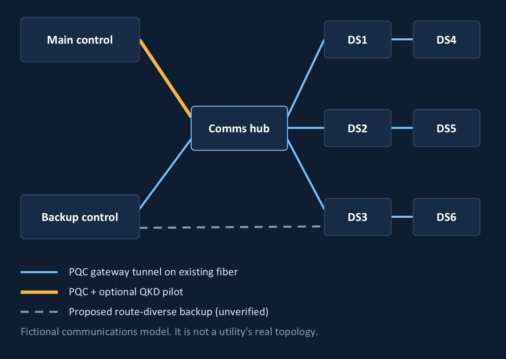

# Secure the Grid: WRITEUP

Track: UTC Secure the Grid. Each answer is labeled by step and Part. The run record for every cloud run is at the end.

# Step 1: Catch the Eavesdropper (BB84)

## Step 1, Part 1: BB84 and Eavesdropper Detection

The team built a BB84 simulation to show how two people can create a shared secret key and check whether someone may have intercepted the qubits. Alice generates random bits and randomly chooses a basis for each one. She encodes each bit as a qubit and sends it to Bob. Bob independently chooses a random basis to measure each qubit. Afterward, Alice and Bob compare their basis choices over a public channel and keep only the bits where they used the same basis. These remaining bits are called the sifted key.

The team tested an intercept-and-resend eavesdropper. Eve measures each qubit in a randomly chosen basis, then prepares a new qubit based on her result and sends it to Bob. If Eve chooses the wrong basis, her measurement can change the state. Alice and Bob estimate the quantum bit error rate (QBER) by comparing their sifted bits.

## Step 1, Part 2: Results

With no eavesdropper, the local simulator produced a QBER of 0.0. With Eve intercepting and resending the qubits, the QBER was 0.243, or about 24%. This is close to the expected error rate of about 25% for this attack: Eve chooses the wrong basis about half the time, and those wrong-basis measurements cause errors in about half of the affected sifted bits. The exact result can vary between runs because the bits, bases, and measurements are random.

The team also tested a batched circuit with 16 qubits and 200 shots. The local simulator gave a QBER of 0.0. The IonQ simulator run gave a QBER of 0.001. Its job ID was `ionq:ionq:sim:simulator-b095-qjob-6af88876c8f5265fb3f1bd01`.

The team then ran the batched circuit on the IonQ Forte 1 quantum processor through Open Quantum, using 200 shots. The hardware QBER was 0.004, or about 0.4%. Its job ID was `openquantum:ionq:qpu:forte-1-b095-qjob-6af88c54c8f5265fb3f1bdde`. This hardware run did not include Eve; the Eve result came from the local simulator.

## Step 1, Part 3: What the Result Shows

The comparison shows how an intercept-and-resend attack can raise the error rate in the sifted key. A higher QBER can warn Alice and Bob that the communication may have been disturbed. It does not identify who caused the errors: noise, transmission problems, or device errors could also raise QBER. A QBER of 0.0 in one run does not prove that nobody intercepted the qubits.

For this demonstration, a QBER around 10% or higher would be a useful warning threshold. It is well above the 0.4% hardware baseline from this run and below the roughly 25% expected from the simulated intercept-and-resend attack. This is only an illustrative threshold for these tests, not a setting for a real QKD system. The threshold for a deployed system would need to account for its measured noise, sample size, and security requirements.

The team also tested a spy who only intercepts some of the qubits (the sweep cell in the notebook). The expected error rate is about one quarter of the fraction Eve intercepts. If Eve intercepts only 2% of the qubits, the expected QBER is about 0.5%, which is close to the 0.4% the hardware showed with no spy at all. So a careful spy who only listens to a few qubits could hide inside normal noise.

Real QKD systems handle this by assuming every error was caused by a spy. They fix the errors with error correction and then use privacy amplification, which shrinks the key until the spy knows almost nothing about what is left. The more errors there are, the more the key shrinks. Above about 11% QBER, BB84 cannot produce a secure key at all and the key is thrown away (Shor and Preskill, 2000).

## Step 1, Part 4: Limits and Use in the Grid

This is a small demonstration of BB84, not a complete key distribution system. In a real deployment, Alice and Bob would need to authenticate their public discussion, compare a sample of the sifted key, and discard the tested bits. They would also need error correction and privacy amplification before using the remaining bits as a key.

BB84 can help protect a key exchange on a suitable quantum link, but it does not encrypt grid traffic by itself or secure every substation and control center. The resulting key would still need to be used by ordinary encryption equipment. These tests do not demonstrate a deployed fiber link or prove that QKD is the most cost-effective choice for a utility. A smaller or resource-limited grid would need to compare QKD’s cost and operating requirements with post-quantum cryptography.

Real QKD systems have been attacked through their hardware and not through the math. In 2010, researchers showed that the detectors in two commercial QKD systems could be controlled with bright light, which let an attacker learn the key without causing errors (Lydersen et al., 2010).

The NSA does not recommend QKD for national security systems. It says QKD does not authenticate who sent the key, needs special equipment, often needs trusted relays, is hard to validate, and raises the risk of denial of service. The UK NCSC says QKD does not provide authentication, will not support it for government or military use, and recommends post-quantum cryptography as the main fix.

Sources:

- P. Shor and J. Preskill, "Simple Proof of Security of the BB84 Quantum Key Distribution Protocol," 2000. https://arxiv.org/abs/quant-ph/0003004
- L. Lydersen et al., "Hacking commercial quantum cryptography systems by tailored bright illumination," 2010. https://arxiv.org/abs/1008.4593
- NSA, "Quantum Key Distribution (QKD) and Quantum Cryptography (QC)." https://www.nsa.gov/Cybersecurity/Quantum-Key-Distribution-QKD-and-Quantum-Cryptography-QC/
- UK NCSC, "Quantum networking technologies." https://www.ncsc.gov.uk/paper/quantum-networking-technologies

## Step 1, Results Table

| Run | Device | Job ID | Shots | Status | Result |
|---|---|---|---|---|---|
| No eavesdropper | Aer local simulator | none (local run) | 200 qubits, 1 shot each | Completed | QBER 0.0 |
| With eavesdropper | Aer local simulator | none (local run) | 200 qubits, 1 shot each | Completed | QBER 0.243 |
| Batched, 16 rounds | Aer local simulator | none (local run) | 200 | Completed | QBER 0.0 |
| Batched, 16 rounds | IonQ simulator | ionq:ionq:sim:simulator-b095-qjob-6af88876c8f5265fb3f1bd01 | 200 | Completed | QBER 0.001 |
| Batched, 16 rounds | IonQ Forte 1 QPU (Open Quantum) | openquantum:ionq:qpu:forte-1-b095-qjob-6af88c54c8f5265fb3f1bdde | 200 | Completed | QBER 0.004 |

**Note** The local simulator has no noise, so it shows 0.0 with no eavesdropper. The IonQ simulator and the real IonQ Forte machine both stayed under 0.5%. With the eavesdropper the error rate jumped to about 24%, which is far above anything the noise caused.

# Step 2: Size Up the Threat

## Step 2, Part 1: Shor Demo (Factor 15)

The team ran Shor's period-finding circuit for N = 15 with base 7. The most useful measured phase was 3/4, giving a period of 4. Using that period, gcd(7² − 1, 15) and gcd(7² + 1, 15) recovered the factors 3 and 5 respectively. Working through the steps showed that the quantum computer's only job is finding the period; the rest is ordinary arithmetic. Since RSA's security depends on factoring being hard, and a variant of Shor's algorithm solves the discrete logarithm problem behind elliptic-curve cryptography, this is the threat to most of the public-key encryption a utility uses today.

## Step 2, Part 2: How Far Is Real Hardware?

The largest machine available through qBraid has 107 qubits, Rigetti Cepheus-1-108Q. For comparison, our factor-15 demo used 8 counting qubits and 4 work qubits for a total of 12. According to Google Quantum AI researcher Gidney (2025), breaking RSA-2048 would take approximately 1,400 error-corrected (logical) qubits, built from just under one million noisy physical qubits, running for under a week. Given Rigetti's max of 107 qubits, the problem would require roughly 9,000 times more physical qubits than currently available, about four orders of magnitude.

In 2019, Gidney and Ekerå estimated 20 million physical qubits for the same task; the 20-fold drop in six years indicates that the gap, while real, is shrinking quickly.

However, qubit count alone understates the gap present. The one million figure already includes the cost of error correction, roughly 700 physical qubits per logical qubit, but it assumes every gate across the entire machine has an error rate of 0.1% or better. Today's devices approach that rate only on small chips, not at the scale of a million qubits. The estimate also assumes the machine runs continuously for days while error correction, including repeated measurement and real-time decoding, keeps pace the entire time.

For reference, error-corrected demonstrations to date have produced at most tens of logical qubits, not 1,400. Thus, the true gap lies in both scale and quality: more qubits, lower error rates across all of them, and sustained error-corrected operation.

References: C. Gidney, "How to factor 2048 bit RSA integers with less than a million noisy qubits," 2025. C. Gidney and M. Ekerå, "How to factor 2048 bit RSA integers in 8 hours using 20 million noisy qubits," 2019.

## Step 2, Part 3: Exposure Map

The utility systems that currently rely on RSA or elliptic-curve cryptography (ECC) include the following, along with how long each must remain secure:

| System | Cryptography | Threat | Service life |
|---|---|---|---|
| firmware update signing | RSA/ECDSA | forged updates | 15–30 years |
| device certificates | RSA/ECDSA | impersonation | 10+ years |
| remote-access VPN | ECDH w/ RSA/ECDSA | harvest now, decrypt later (HNDL) | 5–10 years |
| control center links | TLS/IPsec - ECDH/RSA key exchange | decryption and forgery | 10+ years |
| SCADA/DNP3 | ECDH/RSA key exchange | HNDL | 15–30 years |
| smart meters | ECDH/ECDSA | HNDL | 15–20 years |

## Step 2, Part 4: Migration Plan

The migration follows NIST IR 8547 (finalized October 27, 2026), which deprecates all quantum-vulnerable public-key algorithms after 2030 and disallows them after 2035. Systems are ranked by how exposed they are today and how long they take to fix, with an inventory of every RSA and ECC system running alongside the first fixes rather than delaying them.

1. Firmware signing comes first because it has the longest lead time: a forged update could control a device for its entire service life, and devices shipping today must already carry a post-quantum verification key. It moves to hash-based signatures, either stateful LMS/XMSS (SP 800-208) or stateless SLH-DSA (FIPS 205), along with the PKI root that every device certificate chains back to.
2. In parallel, remote-access VPNs and device certificates, the most likely HNDL targets, move to ML-KEM (FIPS 203) and ML-DSA (FIPS 204) in hybrid mode with existing ECC.
3. Control center links and SCADA follow before 2030, with add-on gateways for older RTUs.
4. Last, symmetric encryption moves to AES-256 for new long-lived links, a simple configuration change (see [Part 5](#step-2-part-5-grover-and-symmetric-keys)).

## Step 2, Stretch

Field devices stay in service for 20 to 30 years, so a device installed today will still be running past NIST's 2035 disallowance date. By Mosca's inequality, if the time a system must stay secure plus the time to migrate exceeds the time until a quantum computer can break RSA, the utility is already late.

The hardest cases are firmware roots of trust burned into read-only memory, which can never be replaced; older RTUs, such as one running an ARM Cortex-M3 with 128 KB of flash, that lack the resources for post-quantum algorithms; protective relays, which must act within milliseconds while ML-DSA signatures are about 2.4 KB compared to 64 bytes for ECDSA; and smart meters and remote substations, where scale, outage windows, and NERC CIP change management slow every update.

Since these systems cannot simply be patched, the utility should require post-quantum support and crypto-agility in all new equipment purchases, protect legacy devices with gateways, segmentation, and the quantum key distribution demonstrated in Step 1, and schedule replacements alongside existing capital cycles.

## Step 2, Part 5: Grover and Symmetric Keys

**What Grover means for AES.** Grover speeds up key guessing by a square root (2^128 keys becomes about 2^64 rounds, which is still a lot), but the rounds must run one after another (e.g. N = 16 requires 3 rounds, and round 2 must wait for round 1 to finish). Splitting the work across many machines isn't as effective, either, as Grover's search barely benefits from parallelization unlike regular brute-force attacks. Using M machines only makes it √M times faster, and every round of a real attack is a full AES computation on an error-corrected quantum computer.

**Key length.** Grover will likely give little or no advantage against AES, and that AES-128 will stay secure for decades. NIST IR 8547 keeps all AES key sizes allowed after 2035. We recommend AES-256 for data and links that must stay secret for 10+ years, as a cheap margin of safety rather than an emergency.

**Compared with RSA: less urgent, and easier.** Shor's algorithm computes RSA and elliptic-curve private keys directly, so longer keys don't save them, and "harvest now, decrypt later" puts today's recorded traffic at risk. Fixing that means new algorithms (ML-KEM, ML-DSA), new certificates and firmware updates on field devices. Moving from AES-128 to AES-256 is usually a configuration change on equipment that already supports it. In our migration plan, the RSA and elliptic-curve replacement comes first, and AES-256 rides along with it.

*Sources:* NIST Post-Quantum Cryptography FAQ; NIST IR 8547 (Transition to Post-Quantum Cryptography Standards); F. Valsorda, "Quantum Computers Are Not a Threat to 128-bit Symmetric Keys" (2026), https://words.filippo.io/128-bits/; https://www.encryptionconsulting.com/grovers-algorithm-and-aes-256/

**Results.** On the noise-free simulator Grover's Search found the key about 100%, 95% and 97% of the time for N = 4, 8 and 16, respectively. 
On IonQ’s simulator with a Forte noise model, it fell to 100%, 79% and 44% as the circuit grew. On Quantinuum's H2 emulator, N = 16 reached 82.5%. How much noise hurts depends heavily on the machine, but every noisy run lost ground as the search grew.

# Step 3: Design the Network

## Step 3, Part 1: Architecture

We designed a small made-up utility network. It has 2 control centers, 1 communications hub and 6 substations (DS1 to DS6). The link lengths are our own guesses for a city-sized network. They are not real EPB data.

| Link | Length (our guess) | Protection |
|---|---|---|
| Main control to hub | 8 km | PQC + optional QKD pilot |
| Backup control to hub | 12 km | PQC |
| Hub to DS1 | 6 km | PQC |
| DS1 to DS4 | 9 km | PQC |
| Hub to DS2 | 7 km | PQC |
| DS2 to DS5 | 11 km | PQC |
| Hub to DS3 | 5 km | PQC |
| DS3 to DS6 | 14 km | PQC |
| Backup control to DS3 | not set | PQC (proposed backup route) |

We also made an interactive map, `chattanooga_grid_map.html`. It shows public power lines and substations around Chattanooga for context, with our proposed links drawn on top. The site locations on it are placeholders, and it does not show real fiber routes. Open the file in a browser and click a link to see why we chose its protection.

We put post-quantum cryptography (PQC) on every link. It works on the equipment and fiber the utility already has, so it is the cheapest way to cover all 6 substations. We would use ML-KEM (FIPS 203) for exchanging keys and ML-DSA (FIPS 204) for signatures.

We only use QKD on one link, main control to hub, and only as an optional pilot. QKD works between two points, so every extra substation would need its own QKD equipment. That adds up fast for a utility on a tight budget.

Trusted nodes: on a long QKD path, the key has to be unlocked and re-locked at each stop in the middle. That means every stop has to be trusted. Our pilot is one short link, so it does not need any trusted nodes.

Distance: QKD makes keys more slowly as the fiber gets longer and loses more light. That is why we picked a short link for the pilot.

Timing: the two ends of a QKD link have to agree on time so they can match what was sent with what was received. QKD does not give the substations their time. The utility would keep using the clocks it already has.

Things our design does not fix: if the fiber is cut, the link needs another path. Both control centers go through the same hub, so if the hub fails, the backup center does not help. That is why we proposed one backup route to DS3 that skips the hub. We have not checked if that route is possible.

## Step 3, Part 2: Assumptions and Tradeoffs

- The network and the link lengths are made up.
- We assumed the utility already has fiber on these links. We did not verify this.
- We did not measure fiber loss or QKD key rate. Those would need to be measured before buying QKD equipment.
- PQC is cheap, but it depends on math problems that we believe are hard. QKD depends on physics, but it needs special hardware, spare fiber and trained staff.
- QKD still needs normal authentication, so it does not replace PQC.

Numbers from the EPB field test (Evans et al., 2021): the test network was about 22 km long and had three QKD links of 3.4 km, 10.2 km and 8.3 km. The fiber loss on those links was 1.3 dB, 3.1 dB and 2.9 dB. Two of the links made secret key at about 1,310 and 1,892 bits per second, with error rates of 3.9% and 1.4%. After the keys were relayed through the trusted nodes, the whole network produced 115 bits per second, which is about one 256-bit key every two seconds. The test ran for 28 hours.

Our 8 km pilot link is in the same range as those links, but we have not measured its loss. A key rate like that is enough to keep refreshing encryption keys. It is not enough to encrypt all the traffic with QKD key directly.

Source: Evans et al., "Trusted Node QKD at an Electrical Utility," IEEE Access, 2021. https://arxiv.org/abs/2103.09877

## Step 3, Part 3: Working Prototype

We picked Option B and built the teleportation circuit in `3_secure_grid_link.ipynb`.

The circuit sends the state of qubit 0 to qubit 2. First we entangle qubits 1 and 2. Then Alice links her message qubit to her half of the pair, and Bob's qubit gets two corrections. To check it, we undo the state on qubit 2 at the end. If the link works, qubit 2 reads 0 every time.

On the local simulator, qubit 2 read 0 on 1,024 of 1,024 shots. On the IonQ simulator with noise, it read 0 on 195 of 200 shots. The job ID was `ionq:ionq:sim:simulator-b095-qjob-6af89604c8f5265fb3f1cbf3`.

These are simulator results. We did not run this on real hardware. All three qubits are on one chip, so it shows the logic works but not that it works over a distance.

This could help with the trusted node problem. In QKD, every stop in the middle has to unlock the key and lock it again, so every stop has to be trusted. With teleportation, a middle stop only passes entanglement along and never holds the key. That needs quantum repeaters, which utilities cannot buy yet, so our design keeps QKD to one short link.

## Step 3, Part 4: Rollout Plan

1. First: make a list of where the utility uses RSA and elliptic-curve cryptography. Fix firmware signing first, since a fake update would do the most damage. Turn on PQC at the control centers and the hub.
2. Next: add PQC at the substations, one branch at a time. Replace old gateways that cannot be updated.
3. Later: measure the fiber on the main control to hub link. Only try the QKD pilot if the measurements and the budget make sense.

## Step 3, Part 5: Cost vs Security

| Option | Cost | What it protects | What is still exposed |
|---|---|---|---|
| Keep what they have | Nothing new | Attackers today | Traffic recorded now can be read later |
| PQC on every link | Software updates and some new gateways | All 8 links | Old devices behind the gateways, hub failure, fiber cuts |
| PQC + QKD pilot | Same as above plus QKD hardware, fiber and staff | Extra check for eavesdropping on 1 link | Same as PQC alone |

We recommend PQC on every link. It protects the whole network for the least money. The QKD pilot only adds protection to one link that PQC already covers, so it should wait until the fiber has been measured.

These costs are our guesses. We looked for public prices for QKD equipment and did not find any, because the vendors do not list them. A real comparison would need a quote.

## Step 3, Stretch

We did not do the QAOA stretch.

# Run Record

Every cloud run, labeled simulator, emulator or QPU, including the ones that failed. Runs on the local Aer simulator have no job ID and are not listed.

| Part | Run | Device | Type | Job ID | Shots | Status | Result |
|---|---|---|---|---|---|---|---|
| Step 1, Part 3 | BB84, 16 rounds in one circuit | IonQ simulator | Simulator | `ionq:ionq:sim:simulator-b095-qjob-6af88876c8f5265fb3f1bd01` | 200 | Completed | QBER 0.001 |
| Step 1, Part 3 | BB84, 16 rounds in one circuit | IonQ Forte 1 (Open Quantum) | QPU | `openquantum:ionq:qpu:forte-1-b095-qjob-6af88c54c8f5265fb3f1bdde` | 200 | Completed | QBER 0.004 |
| Step 1, Part 3 | BB84, 16 rounds in one circuit | IonQ Forte 1 (Open Quantum) | QPU | `openquantum:ionq:qpu:forte-1-b095-qjob-6af88b54c8f5265fb3f1bdaa` | 200 | Failed | Rejected before running: the circuit left one qubit unused |
| Step 1, Part 3 | BB84, 16 rounds in one circuit | IonQ Forte 1 (Open Quantum) | QPU | `openquantum:ionq:qpu:forte-1-b095-qjob-6af88ac6c8f5265fb3f1bd8d` | 200 | Failed | Open Quantum terms not accepted yet |
| Step 1, Part 3 | BB84, 16 rounds in one circuit | IonQ Forte 1 (Open Quantum) | QPU | `openquantum:ionq:qpu:forte-1-b095-qjob-6af88a4bc8f5265fb3f1bd6e` | 200 | Failed | Open Quantum terms not accepted yet |
| Step 1, Part 3 | BB84, 16 rounds in one circuit | IonQ Forte 1 (Open Quantum) | QPU | `openquantum:ionq:qpu:forte-1-b095-qjob-6af8896cc8f5265fb3f1bd3a` | 200 | Failed | Open Quantum account not connected yet |
| Step 1, Part 3 | BB84, earlier practice run | IonQ simulator | Simulator | `ionq:ionq:sim:simulator-b095-qjob-6af7c852f15852ed27b72101` | 200 | Completed | Not used in the write-up |
| Step 1, Part 3 | BB84, earlier practice run | IonQ simulator | Simulator | `ionq:ionq:sim:simulator-b095-qjob-6af7c842f15852ed27b720fa` | 200 | Completed | Not used in the write-up |
| Step 2, Part 5 | Grover, N=4 | IonQ simulator (forte-1 noise model) | Simulator | `ionq:ionq:sim:simulator-0ad7-qjob-6af7e58ef15852ed27b72b26` | 200 | Completed | 200/200 on key (100%) |
| Step 2, Part 5 | Grover, N=8 | IonQ simulator (forte-1 noise model) | Simulator | `ionq:ionq:sim:simulator-0ad7-qjob-6af86a41c8f5265fb3f1b033` | 200 | Completed | 158/200 on key (79%) |
| Step 2, Part 5 | Grover, N=16 | IonQ simulator (forte-1 noise model) | Simulator | `ionq:ionq:sim:simulator-0ad7-qjob-6af7e25ef15852ed27b72a6b` | 200 | Completed | 87/200 on key (44%) |
| Step 2, Part 5 | Grover, N=16 | Quantinuum H2 emulator | Emulator | `quantinuum:quantinuum:sim:h2-emulator-0ad7-qjob-6af86c52c8f5265fb3f1b0ee` | 200 | Completed | 165/200 on key (82.5%) |
| Step 3, Part 3 | Teleportation link | IonQ simulator (forte-1 noise model) | Simulator | `ionq:ionq:sim:simulator-b095-qjob-6af89604c8f5265fb3f1cbf3` | 200 | Completed | Qubit 2 read 0 on 195/200 |
| Step 3, Part 3 | Teleportation link, earlier run | IonQ simulator (forte-1 noise model) | Simulator | `ionq:ionq:sim:simulator-b095-qjob-6af7d2bdf15852ed27b723ed` | 200 | Completed | Qubit 2 read 0 on 197/200 |
| Step 3, Part 3 | Teleportation link, earlier run | IonQ simulator (forte-1 noise model) | Simulator | `ionq:ionq:sim:simulator-b095-qjob-6af7d2b7f15852ed27b723df` | 200 | Completed | Not used in the write-up |
| Step 3, Part 3 | Teleportation link, earlier run | IonQ simulator (forte-1 noise model) | Simulator | `ionq:ionq:sim:simulator-b095-qjob-6af7d2a7f15852ed27b723d5` | 200 | Completed | Not used in the write-up |
