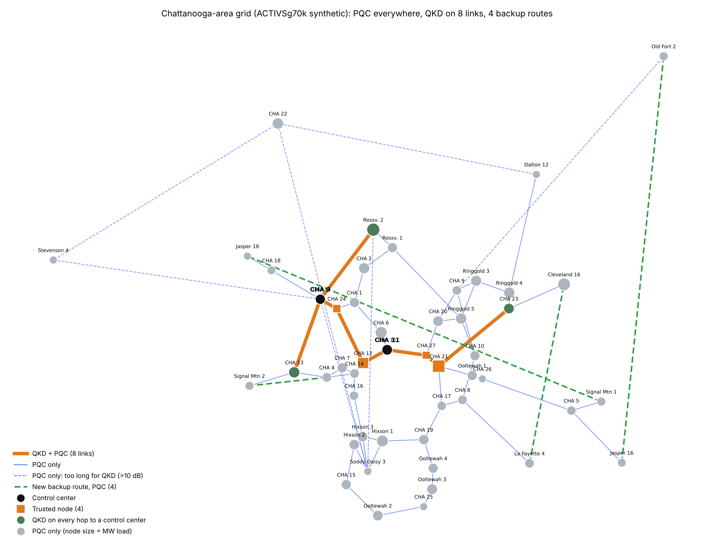

# Step 3 - Design the Network

## Part 1: Architecture

A real utility's network layout is restricted information, so we did not use EPB's real network. We used the Texas A&M ACTIVSg70k synthetic grid. It is made up, but it was built to match real U.S. grids and it sits on real towns. We kept every Chattanooga substation plus its direct neighbors, which gives 49 substations and 65 links. The design went through three versions: `3b_network_design.ipynb` (version 0), `3c_network_design_v1.ipynb` (version 1) and the final one in `network_design/final_design.py`, which writes `network_design/final_design.json`.

Orange links carry QKD and PQC. Blue links are PQC only, and dashed blue links are too long for QKD. Dashed green links are new backup routes. Orange squares are trusted nodes.

| What | Number |
|---|---|
| Substations | 49 |
| Links | 65 |
| Link length | 2.1 km shortest, 6.8 km median, 83.1 km longest |
| Links short enough for QKD | 58 of 65 |
| Control centers | 2 (CHATTANOOGA 3 and CHATTANOOGA 11) |
| Links with PQC | all 65 |
| Links with QKD | 8 |
| Trusted nodes | 4 |
| Load with QKD on every hop to a control center | 316.7 of 1,406.4 MW |
| New backup routes | 4 |

We put post-quantum cryptography (PQC) on every link. It works on the equipment and fiber the utility already has, so it covers all 49 substations no matter how long the link is. We would use ML-KEM (FIPS 203) for exchanging keys and ML-DSA (FIPS 204) for signatures, running next to the encryption used today, as in our Step 2 plan.

QKD only goes on a few links, and an optimizer picks them. Each substation gets a score: the load it carries, times the chance its traffic gets tapped, times the chance the BB84 alarm catches the tap. The score drops a little for every trusted node the key passes through. The link between the two control centers counts as the whole system's load, because it carries data about everything. The final version also gives credit for catching taps on the busiest fiber. The optimizer is an integer program. It finds the best set of links for the budget.

With a budget of 8 QKD links and no more than 4 trusted nodes, it picked these links:

- CHATTANOOGA 3 to CHATTANOOGA 24 (3.7 km), CHATTANOOGA 24 to CHATTANOOGA 12 (10 km) and CHATTANOOGA 12 to CHATTANOOGA 11 (4.9 km). These 3 links join the two control centers.
- CHATTANOOGA 11 to CHATTANOOGA 27 (6.6 km), CHATTANOOGA 27 to CHATTANOOGA 21 (3.1 km) and CHATTANOOGA 21 to CHATTANOOGA 23 (13.6 km).
- CHATTANOOGA 3 to ROSSVILLE 2 (14 km).
- CHATTANOOGA 3 to CHATTANOOGA 13 (16 km).

That puts 8 substations behind QKD on every hop to a control center. Together they carry 316.7 MW, which is 22.5% of the 1,406.4 MW on this grid.

Version 1 in `3c` only scored secrecy. At the same budget it picked 7 links and reached 83% of the most risk reduction possible. The budget numbers in Parts 4 and 5 come from that version.

Distance: we assumed a fiber loss of 0.35 dB/km, which is what was measured on EPB's fiber, and that a link can carry QKD if its loss is 10 dB or less. That is about 28.6 km. 7 of the 65 links are longer than that, so they get PQC only.

Number of substations: QKD works between two points, so on a small budget it cannot reach 49 substations. PQC can. That is why QKD is only on 8 links.

Trusted nodes: when a key passes through a substation in the middle, it is unlocked and locked again there, so that substation has to be trusted. Our design has 4 of them: CHATTANOOGA 12, CHATTANOOGA 21, CHATTANOOGA 24 and CHATTANOOGA 27. Every QKD chain is 3 hops or less, which is the length EPB tested.

Timing: the two ends of a QKD link have to agree on time so they can match what was sent with what was received. QKD does not give the substations their time. The utility would keep using the clocks it already has.

Backup routes: 11 substations had only one path to a control center, so a single fiber cut could cut them off. The worst cut would drop 76.8 MW. The design adds 4 backup routes with PQC: SIGNAL MOUNTAIN 1 to JASPER 18 (74.3 km), LA FAYETTE 4 to CLEVELAND 16 (52.3 km), OLD FORT 2 to JASPER 16 (109 km) and CHATTANOOGA 4 to SIGNAL MOUNTAIN 2 (15.5 km). That is 251.1 km in total. After that, no single cut isolates a substation. These routes are proposed and the lengths are estimates. We have not checked that fiber exists along them.

## Part 2: Assumptions and Tradeoffs

- The grid is synthetic. It is not EPB's real network.
- We assumed the fiber follows the power lines. Link lengths are estimated from each line's electrical values. They are not measured.
- Fiber loss is assumed to be 0.35 dB/km and the QKD limit 10 dB. Real fiber would have to be measured before buying QKD equipment.
- The grid model does not say where the control centers are. The highest-voltage, most central Chattanooga substation stands in for the main one (CHATTANOOGA 3), and the most central substation within 3 hops stands in for the backup (CHATTANOOGA 11).
- The chance of a tap, the chance the alarm catches it, and the risk at a trusted node are our guesses. To see if the guesses decide the answer, the version 1 optimizer was run 400 times with different values. 4 links were picked every time, and all 4 are in the final design.
- Line noise on a link is assumed to be 2.5%. EPB measured 1.4% to 3.9%.
- PQC is cheap, but it depends on math problems that we believe are hard. QKD depends on physics, but it needs special hardware, spare fiber and trained staff.
- QKD still needs normal authentication, so it does not replace PQC.

Numbers from the EPB field test (Evans et al., 2021): the test network was about 22 km long and had three QKD links of 3.4 km, 10.2 km and 8.3 km. The fiber loss on those links was 1.3 dB, 3.1 dB and 2.9 dB. Two of the links made secret key at about 1,310 and 1,892 bits per second, with error rates of 3.9% and 1.4%. After the keys were relayed through the trusted nodes, the whole network produced 115 bits per second, which is about one 256-bit key every two seconds. The test ran for 28 hours.

Most of our links are in the same range as those links: the median is 6.8 km. A key rate like that is enough to keep refreshing encryption keys. It is not enough to encrypt all the traffic with QKD key directly.

Sources:

- Evans et al., "Trusted Node QKD at an Electrical Utility," IEEE Access, 2021. https://arxiv.org/abs/2103.09877
- Birchfield et al., IEEE Transactions on Power Systems, 2017 (the ACTIVSg70k synthetic grid, from MATPOWER's copy of the case).

## Part 3: Working Prototype

We built both options.

**Teleportation link (Option B).** We built the teleportation circuit in `3_secure_grid_link.ipynb`.

The circuit sends the state of qubit 0 to qubit 2. First we entangle qubits 1 and 2. Then Alice links her message qubit to her half of the pair, and Bob's qubit gets two corrections. To check it, we undo the state on qubit 2 at the end. If the link works, qubit 2 reads 0 every time.

On the local simulator, qubit 2 read 0 on 1,024 of 1,024 shots. On the IonQ simulator with noise, it read 0 on 195 of 200 shots. The job ID was `ionq:ionq:sim:simulator-b095-qjob-6af89604c8f5265fb3f1cbf3`.

These are simulator results. We did not run this on real hardware. All three qubits are on one chip, so it shows the logic works but not that it works over a distance.

This could help with the trusted node problem. In QKD, every stop in the middle has to unlock the key and lock it again, so every stop has to be trusted. With teleportation, a middle stop only passes entanglement along and never holds the key. That needs quantum repeaters, which utilities cannot buy yet, so our design keeps QKD chains to 3 hops and treats every middle stop as a trusted node.

**BB84 as a link in the design (Option A).** In `3a_bb84_grid_link.ipynb` we ran BB84 as one link from the design: the 3.7 km link from control center CHATTANOOGA 3 to CHATTANOOGA 24. With 2.5% line noise the quiet link had a QBER of 0.025, so the alarm is set at 0.034. A full tap raised the QBER to 0.269. The alarm caught a tap on 15% of the rounds 98% of the time, but a tap on 5% of the rounds only 63% of the time. So a small tap can still hide.

Through qBraid, the quiet link gave a QBER of 0.000 on the qBraid QIR simulator and on the IonQ simulator. The fully tapped link gave 0.426 and 0.433. Each of those runs is one small batch with about 6 usable rounds, so the result depends on a handful of random choices and came out above the 0.269 average.

**A better alarm.** In `3d_alarm_threshold.ipynb` we tested alarms on line noise that drifts. All three were tuned to about 1 false alarm per 1,000 batches. The table shows how often each one caught the tap.

| Tap size | Fixed threshold | Kalman filter | Kalman + CUSUM |
|---|---|---|---|
| 1% of rounds | 6% | 28% | 50% |
| 2% of rounds | 7% | 32% | 65% |
| 5% of rounds | 20% | 95% | 100% |

Wind gusts on the fiber still fooled every alarm that only looks at QBER. Adding a normal fiber monitor as a second signal raised the catch rate for a 2% tap from 56% to 84%.

**Attacks.** In `3f_attacks_on_hardware.ipynb` we tried five attacks on the local simulator with 2.5% line noise. Each attack is one small circuit, so the numbers are rough. The quiet link had a QBER of 0.024, a full tap 0.174, a partial tap 0.092, and a denial of service attack 0.584. A blinding attack kept the QBER at 0.026, but only 67% of the rounds gave a result. So the error check misses it, and it takes a click-rate monitor to catch it. The tap, partial tap and denial of service circuits were also sent to the IonQ Forte 1 quantum computer. Those results are not in the notebook yet.

## Part 4: Rollout Plan

1. First: make a list of where the utility uses RSA and elliptic-curve cryptography. Fix firmware signing first, since a fake update would do the most damage. Turn on PQC at the two control centers.
2. Next: add PQC at the other 47 substations. Replace old gateways that cannot be updated.
3. Then, if the budget allows QKD: measure the fiber, and start with the chain that joins the two control centers (CHATTANOOGA 3 to 24 to 12 to 11). In the budget chart in `3c_network_design_v1.ipynb`, the risk reduced jumps from under 10% at a budget of 3 links to about 70% at 4 links, and this chain is the reason. These 3 links and CHATTANOOGA 3 to ROSSVILLE 2 were picked in all 400 test runs of version 1, so they are the safest first purchases.
4. Later: add the other 4 QKD links, and build the 4 backup routes for the 11 substations that have only one path.

## Part 5: Cost vs Security

| Option | Cost | What it protects | What is still exposed |
|---|---|---|---|
| Keep what they have | Nothing new | Attackers today | Traffic recorded now can be read later |
| PQC on every link | Software updates and some new gateways | All 65 links | Old devices behind the gateways, fiber cuts |
| PQC + QKD on 8 links + 4 backup routes | Same as above plus 8 QKD links, 4 hardened trusted nodes, about 251 km of backup route, fiber and staff | Adds physics-based keys and tap detection where the risk is highest (316.7 MW behind QKD), and no single fiber cut isolates a substation | Anything a real survey of the fiber turns up |

We recommend PQC on every link first. It protects the whole network for the least money. QKD comes second, starting with the control center chain, and only after the fiber has been measured.

More budget helps less and less. In version 1's budget chart, the first 4 links get to about 70%, 8 links get to 83%, and it takes about 25 links to reach 100%. Where the QKD goes matters more than how much is bought: at the same budget of 8 links, picking the busiest links first reached under 5%. A simple greedy method came within 0.5% of the optimizer, so a careful engineer could get close by hand. The optimizer makes sure of it. The 70%, the 25 links and the 5% are read off the budget chart in `3c_network_design_v1.ipynb`.

We do not have real prices. The budget is counted in QKD links, with a trusted node counted as 0.2 of a link, because QKD vendors do not publish prices. A real comparison would need a quote.

## Stretch

We did the QAOA stretch in `3e_qaoa_vs_classical.ipynb`. We gave QAOA a small version of the problem, choosing which links get QKD on a budget, at 10 and 12 qubits, and compared it with classical methods.

- The exact solver and the greedy method found the best answer every time, in about 0.01 seconds.
- Standard QAOA at 10 qubits returned the best answer on 0.24% to 0.31% of shots. Random guessing within the budget gets 0.40%, so standard QAOA did worse than guessing.
- XY-mixer QAOA did better, up to 1.68% at 10 qubits and 0.29% at 12 qubits.
- The standard QAOA circuits need 106 to 318 two-qubit gates at 10 qubits, which is too many for today's hardware.
- Through qBraid, the 10-qubit circuit stayed within the budget on 58% of shots on the qBraid QIR simulator and 52% on the IonQ simulator. It found the best answer on 0.10% of shots on both.

So we use classical optimization to plan the network, and quantum for the key exchange and the tap detection.
